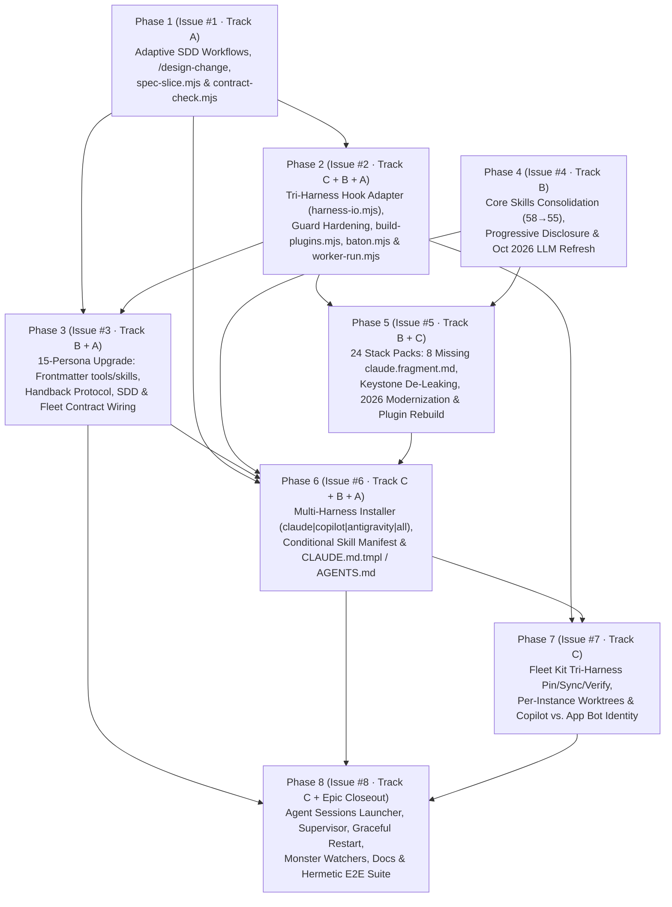

# Unified Epic Specification: `engsys` Next-Gen Architecture (`v2.0` / `EPIC-2026-ENGSYS-NEXT`)

> **Harmonizing Track A ([Adaptive SDD](file:///Users/eric/git/engineering/engsys-sdd-upgrade-spec.md)), Track B ([Personas & Skills Upgrade](file:///Users/eric/git/engineering/engsys_personas_skills_evaluation.md)), and Track C ([Multi-Harness `claude` | `copilot` | `antigravity`](file:///Users/eric/git/engineering/multi-harness-antigravity-spec.md)) into a Single Zero-Conflict 8-Phase Implementation Epic.**

---

## 1. Executive Summary & Scope

### Scope & Spec Tier Recommendation
- **Recommended Tier**: `Tier L` (Master Unified Epic — 8 dependency-ordered implementation PR phases across `core/`, `optional-agents/`, `stacks/`, `lib/`, `scripts/`, and `docs/`).
- **Unified Escalation Tripwire Taxonomy (`TW-1..TW-6`)**:
  - `[x] TW-1` **Data Model / Schema Migration**: Mutates `engsys.config.yaml` (`harness:`), `engsys.lock`, `fleet.conf` (`HARNESS=`), `pin.json`, `plugins.json`, `docs/specs/<slug>.md` YAML frontmatter, and `<!-- engsys:issue-meta -->` (`spec_refs`).
  - `[x] TW-2` **Public API / CLI / Wire Protocol**: Adds `/design-change`, `engsys install --harness`, `fleet init|pin|sync|verify --harness`, `core/lib/harness-io.mjs` tri-harness hook protocol, `core/lib/spec-slice.mjs`, and `core/lib/contract-check.mjs`.
  - `[x] TW-3` **Auth / Trust Boundary / Security**: Hardens `singleton-write-guard.mjs` across `.claude/`, `.github/copilot/`, `$COPILOT_HOME/`, `.gemini/`, `.agents/`; upgrades `verify-wrappers.mjs` for JSONC + `.agents/plugins.json` + global shadowing prevention; separates Copilot CLI seat auth from Fleet GitHub App bot tokens in `core/fleet/identity/bin/gh`; enforces least-privilege `tools:` scopes across all 15 personas; adds AI/Agentic/MCP security rules to `nyx.md`.
  - `[x] TW-4` **Multi-PR / Cross-Subsystem**: 8 implementation phases (`Issue #1` through `Issue #8`) spanning 3 sub-specifications.
  - `[x] TW-5` **AI / LLM / Agentic Pipeline**: Adds `_copilot-cli.mjs` and `_agy-cli.mjs` worker execution providers, refreshes `llm-structured-outputs` and `otto.md` for October 2026 frontier models (`claude-opus-5-5`, `claude-sonnet-5-5`, `claude-haiku-5-5`, `claude-opus-4-8`, `gpt-6-astra`, `gpt-6.1-sol`, `gpt-6-luna`, `gemini-4-argon`, `gemini-3.8-flash`, `deepseek-v4-pro`, `deepseek-flash`, `grok-4.7`), and binds skills/tools in persona frontmatter.
  - `[x] TW-6` **Infra / CI / Deploy Topology**: Upgrades `scripts/build-plugins.mjs`, isolates per-instance `$FLEET_STATE/engsys` git worktrees in `fleet sync`, and modernizes `gcp-deployment-preflight` and `iac-terraform`.

---

## 2. Cross-Spec Harmonization & Conflict Resolution Matrix

When the three specifications were drafted in separate sessions, they overlapped on **6 shared architectural surfaces**. The table below records the canonical harmonization decision applied across all three specs:

| # | Conflict / Overlap Surface | Original Divergence Across Specs | Canonical Harmonized Resolution | Epic Phase |
|---|---|---|---|---|
| **H-1** | **Escalation Tripwire Taxonomy** | `engsys-sdd-upgrade-spec.md` defined 5 tripwires (`TW-1..TW-5`, with `TW-5` as Infra/CI); `engsys_personas_skills_evaluation.md` added `TW-5` as AI/LLM Pipeline (`Otto`) and `TW-6` as Infra/CI (`Aaron`); `multi-harness-antigravity-spec.md` used a 4-tripwire shorthand (`TW-1..TW-4`). | Standardize on the **6-Tripwire Taxonomy (`TW-1..TW-6`)** everywhere: `TW-1` Data/Schema, `TW-2` API/CLI/Wire, `TW-3` Auth/Security (`Nyx`), `TW-4` Multi-PR (`>1 PR`), `TW-5` AI/LLM/Agentic (`Otto` + `Marcelo` `agentic-eval`), `TW-6` Infra/CI/Deploy (`Aaron`). | **Phase 1 (`Issue #1`)** |
| **H-2** | **`scripts/build-plugins.mjs` & Stack Pack Hooks** | Track C modified `core/.claude-plugin/` and added `core/plugin.json` + `core/hooks.json`, while Track B added 8 missing `claude.fragment.md` files to `stacks/`. Neither spec accounted for `scripts/build-plugins.mjs` generating `core/.claude-plugin/` and all 24 `stacks/**/.claude-plugin/{plugin.json,hooks.json,context.sh,post-edit.sh}` files (`--check` in CI). | Update [`scripts/build-plugins.mjs`](file:///Users/eric/git/engineering/engsys/scripts/build-plugins.mjs) in **Phase 2 (`Issue #2`)** so `packContextSh()` and `packPostEditSh()` emit dual-compatible JSON (`additionalContext` + `hookSpecificOutput.additionalContext`) for Claude & Copilot CLI, and generate root `core/plugin.json` + `core/hooks.json` for Antigravity. Then in **Phase 5 (`Issue #5`)**, add the 8 missing `claude.fragment.md` files and run `node scripts/build-plugins.mjs` to regenerate all 24 stack plugins. | **Phase 2 (`Issue #2`)** & **Phase 5 (`Issue #5`)** |
| **H-3** | **`handback-guard.mjs`, Copy-Mode `settings.json.tmpl` & Persona Footers** | Track C upgraded `handback-guard.mjs` to emit `{"decision": "block", "reason": "..."}` via `harness-io.mjs`, while Track B noted that 0/15 personas document `STATUS: COMPLETE|INCOMPLETE` and copy-mode `settings.json.tmpl` never registers `handback-guard.mjs`. | **Phase 2 (`Issue #2`)** upgrades `handback-guard.mjs` (`harness-io.mjs`) AND wires `SubagentStop` + `Stop` into `core/templates/settings.json.tmpl`. **Phase 3 (`Issue #3`)** adds the canonical `## Handback Protocol` (`STATUS: COMPLETE` / `STATUS: INCOMPLETE — <what remains>`) to all 15 persona `.md` files. | **Phase 2 (`Issue #2`)** & **Phase 3 (`Issue #3`)** |
| **H-4** | **Persona `model:` & `tools:` Frontmatter Across Harnesses** | Track B noted persona `model:` uses `opus`/`sonnet` (`steve` should be `haiku`) and read-only critics lack `tools:` restrictions. Track C noted Antigravity subagents use `.agents/agents/*.md` (`enable_write_tools`). Meanwhile, Claude Code `2.1.285`'s `Agent` tool rejects full model IDs in frontmatter and requires tier aliases (`opus`, `sonnet`, `haiku`, `fable`). | Keep `model: opus | sonnet | haiku` (`steve: haiku`) + explicit `tools:` and `skills:` arrays in `core/agents/*.md` and `optional-agents/*.md` (**Phase 3**). In **Phase 6 (`Issue #6`)**, `lib/render.js` translates read-only `tools: [Read, Grep, Glob, Write]` into `enable_write_tools: false` when materializing `.agents/agents/*.md` for `antigravity`. | **Phase 3 (`Issue #3`)** & **Phase 6 (`Issue #6`)** |
| **H-5** | **Skill Consolidation (`58 → 55`) vs. Multi-Harness Installer (`lib/manifest.js`)** | Track B consolidated `git-commit` $\rightarrow$ `git-workflow-agents`, `github-issues` $\rightarrow$ `issue-tracker-github`, and `terraform-conventions` $\rightarrow$ `iac-terraform`, and required conditional pruning of `gh-cli` on `issue_tracker: linear`. Track C rewrote `lib/manifest.js`, `lib/render.js`, and `lib/commands.js` for `harness: claude | copilot | antigravity | all`. | Execute all `core/skills/**` consolidations in **Phase 4 (`Issue #4`)** and all `stacks/**` updates in **Phase 5 (`Issue #5`)** FIRST. Then touch `lib/manifest.js`, `lib/render.js`, `lib/commands.js`, and `core/templates/CLAUDE.md.tmpl` ONCE in **Phase 6 (`Issue #6`)** to implement both multi-harness materialization and conditional skill pruning (`RETIRED_CORE_SKILLS` + `includeGhCli`). | **Phase 4 (`Issue #4`)**, **Phase 5 (`Issue #5`)**, **Phase 6 (`Issue #6`)** |
| **H-6** | **Worker Packaging (`worker-package.mjs`), Execution (`worker-run.mjs`) & Preflight (`mm-preflight.sh`)** | Track A added `spec-slice.mjs` to `worker-package.mjs` and `contract-check.mjs` to `worker-run.mjs` + `mm-preflight.sh`. Track C added `_copilot-cli.mjs` and `_agy-cli.mjs` to `worker-run.mjs`. | **Phase 1 (`Issue #1`)** creates `core/lib/spec-slice.mjs` and `core/lib/contract-check.mjs`, and wires `worker-package.mjs` and `mm-preflight.sh`. **Phase 2 (`Issue #2`)** touches `worker-run.mjs` once to wire `_copilot-cli.mjs`, `_agy-cli.mjs`, AND the post-run `contract-check.mjs` verification gate. | **Phase 1 (`Issue #1`)** & **Phase 2 (`Issue #2`)** |

---

## 3. Master 8-Phase Dependency DAG & File Touch Isolation

Every file in `engsys` is assigned to a specific phase so that parallelizable phases (`Phase 1` and `Phase 4`; `Phase 3` and `Phase 5`) have **disjoint `touches` sets** and can be executed by `isabelle` or external workers without merge conflicts.



### Parallel Execution Waves
- **Wave 1 (No Dependencies — Run in Parallel)**:
  - **Phase 1 (`Issue #1`)**: Core SDD workflows, `/design-change`, `spec-slice.mjs`, `contract-check.mjs`, `worker-package.mjs`, `mm-preflight.sh`.
  - **Phase 4 (`Issue #4`)**: `core/skills/**` consolidation, broken-link fixes, progressive disclosure (`references/`), `llm-structured-outputs` Oct 2026 refresh.
- **Wave 2 (`depends_on: [1]`)**:
  - **Phase 2 (`Issue #2`)**: `core/lib/harness-io.mjs`, `core/.claude-plugin/*`, `scripts/build-plugins.mjs`, `core/templates/{settings.json,post-compact-reground.sh,post-clear-reground.sh}.tmpl`, `core/lib/lease/baton.mjs`, `core/scripts/providers/{_copilot-cli,_agy-cli}.mjs`, `core/scripts/worker-run.mjs`.
- **Wave 3 (`depends_on: [1, 2, 4]` — Run in Parallel)**:
  - **Phase 3 (`Issue #3`, `depends_on: [1, 2]`)**: All 15 personas (`core/agents/*.md`, `optional-agents/*.md`) + `core/commands/design-{critique,audit}.md`.
  - **Phase 5 (`Issue #5`, `depends_on: [2, 4]`)**: All 24 stack packs (`stacks/**`) + `.claude-plugin/marketplace.json` regeneration.
- **Wave 4 (`depends_on: [1, 3, 4, 5]`)**:
  - **Phase 6 (`Issue #6`)**: `install`, `engsys.config.example.yaml`, `core/templates/CLAUDE.md.tmpl`, `lib/{manifest,render,commands,selftest}.js`.
- **Wave 5 (`depends_on: [2, 6]`)**:
  - **Phase 7 (`Issue #7`)**: `core/fleet/{pin,sync,verify,install-jobs}.sh`, `core/fleet/lib/{fleet-env.sh,verify-wrappers.mjs}`, `core/fleet/identity/bin/gh`, `core/fleet/scaffold/**`, `core/fleet/test/**`.
- **Wave 6 (`depends_on: [3, 6, 7]`)**:
  - **Phase 8 (`Issue #8`)**: `core/skills/agent-sessions/scripts/**`, `core/fleet/{launch,restart,msg}.sh`, monster watchers, `README.md`, `docs/*.md`, full E2E verification.

---

## 4. Unified Security & Privacy Invariants (`Nyx`)

| ID | Track | Negative Assertion / Security Invariant | Enforcement Mechanism |
|---|---|---|---|
| **`NA-SDD-1`** | Track A | `spec-slice.mjs` and `contract-check.mjs` MUST reject any `spec_refs` path containing `..`, leading `/`, or resolving via symlink outside the repository root (`exit 2`). | `core/lib/spec-slice.mjs` + `CT-SDD-02` |
| **`NA-SDD-2`** | Track A | `contract-check.mjs` MUST execute as a pure static file/AST/diff analyzer (`git diff`, `fs.readFileSync`) and MUST NOT `eval()` or execute untrusted code from spec markdown blocks. | `core/lib/contract-check.mjs` + `CT-SDD-04` |
| **`NA-SDD-3`** | Track A | Any issue firing `TW-3` (Auth / Trust Boundary / Security) MUST NOT be classified as `Tier S` and MUST include `Nyx` negative assertions (`NA-*`). | `core/workflows/generate-project.md` |
| **`NA-SDD-4`** | Track A | Any diff touching files outside `<!-- engsys:issue-meta -->` `touches` globs MUST fail `contract-check.mjs` (`exit 1`) unless justified in the PR body under `### Co-commit justification`. | `core/lib/contract-check.mjs` + `CT-SDD-05` |
| **`NA-PS-1`** | Track B | Read-only critic and design personas (`gary`, `melvin`, `nyx`, `leith`, `otto`, `jos`, `sandy`, `deandre`, `steve`) MUST NOT list `Bash` or `Edit` in their frontmatter `tools:` array (and MUST carry `enable_write_tools: false` in `.agents/agents/*.md`). | `tests/personas-and-skills.test.mjs` (`CT-PS-01`) + `lib/render.js` |
| **`NA-PS-2`** | Track B | No skill or persona file in `core/` or `stacks/` may recommend `git commit -m "$(cat <<'EOF' ...)"` or any subshell `$()` inside `git commit` / `gh issue create` / `gh pr create`. | `tests/personas-and-skills.test.mjs` (`CT-PS-03`) |
| **`NA-PS-3`** | Track B | No skill in `core/skills/` or `stacks/` may instruct agents to fall back to `mcp__github__*` when `gh` CLI fails. | `tests/personas-and-skills.test.mjs` (`CT-PS-04`) |
| **`NA-PS-4`** | Track B | `nyx.md` and `core/skills/security-review/SKILL.md` MUST audit AI/LLM/MCP surfaces (`TW-5`) for indirect prompt injection, `<untrusted_input>` boundary spoofing, MCP tool poisoning, and cross-tenant vector/memory leaks. | `core/agents/nyx.md` + `core/skills/security-review/SKILL.md` |
| **`NA-PS-5`** | Track B | No skill in `core/skills/` or `stacks/` may contain private monorepo identifiers (`useThemeGrid`, `JudgmentChip`, `signalsExportApi`, `content_raw`, `services/database/index.ts`, `ff-engsys-fleet`). | `tests/personas-and-skills.test.mjs` (`CT-PS-07`) |
| **`NA-MH-1`** | Track C | Given `ENGSYS_SINGLETON_ROLE=merge|maintain` and a `PreToolUse` payload from `claude`, `copilot`, or `antigravity` invoking unfenced `gh pr merge` or `git push`, `singleton-write-guard.mjs` MUST deny the call. | `core/.claude-plugin/singleton-write-guard.test.mjs` (`CT-02`, `CT-04`) |
| **`NA-MH-2`** | Track C | Given `ENGSYS_SINGLETON_ROLE=merge|maintain`, `singleton-write-guard.mjs` MUST deny writes to `.claude/**`, `.github/hooks/**`, `.github/copilot/**`, `$COPILOT_HOME/**`, `.gemini/**`, `.agents/**`, `.git/config`, or `~/.gitconfig`. | `core/.claude-plugin/singleton-write-guard.test.mjs` (`CT-03`, `CT-04`) |
| **`NA-MH-3`** | Track C | Given `HARNESS=claude|copilot|antigravity` and a single modified byte, extra file, or symlink inside the active plugin root, `verify.sh` MUST exit `1` (`verify: MISMATCH`) and hold monster launch. | `core/fleet/lib/verify-wrappers.test.mjs` (`CT-11`) |
| **`NA-MH-4`** | Track C | Given `HARNESS=antigravity` and a global plugin in `~/.gemini/config/plugins/` declaring `"name": "engsys"`, `verify-wrappers.mjs` MUST report a `shadowed` mismatch (`exit 1`). | `core/fleet/lib/verify-wrappers.test.mjs` (`CT-12`) |
| **`NA-MH-5`** | Track C | Given `HARNESS=copilot` with `GH_APP_ENV`, child agent shells (`PPID != copilot`) MUST receive the Fleet GitHub App token (`ghs_...`), while `copilot`'s own `gh auth token` check delegates to `$REAL_GH`. | `core/fleet/test/identity.test.sh` (`CT-09`) |

---

## 5. Complete 8-Phase Implementation Plan (`Jody`)

Each phase below is a self-contained implementation issue with its machine-parseable `<!-- engsys:issue-meta -->` block ready to file via `issue-tracker-*`.

### Phase 1 (`Issue #1` · Track A): Core Adaptive SDD Workflows, `/design-change`, `spec-slice.mjs` & `contract-check.mjs`

- **Sub-Spec Reference**: [`engsys-sdd-upgrade-spec.md`](file:///Users/eric/git/engineering/engsys-sdd-upgrade-spec.md)
- **Summary**:
  1. Create [`core/lib/spec-slice.mjs`](file:///Users/eric/git/engineering/engsys-sdd-upgrade-spec.md#L121-L143) to parse `<!-- engsys:issue-meta -->` `spec_refs` and extract exact markdown headings from `docs/specs/<slug>.md` with path-traversal protection (`NA-SDD-1`).
  2. Create [`core/lib/contract-check.mjs`](file:///Users/eric/git/engineering/engsys-sdd-upgrade-spec.md#L145-L169) to statically verify `touches` glob compliance, `spec_refs` heading existence, and `Marcelo` contract test Case ID presence (`NA-SDD-2`, `NA-SDD-4`).
  3. Add [`core/commands/design-change.md`](file:///Users/eric/git/engineering/engsys-sdd-upgrade-spec.md#L76-L99) and upgrade [`core/commands/generate-project.md`](file:///Users/eric/git/engineering/engsys/core/commands/generate-project.md) and [`core/workflows/generate-project.md`](file:///Users/eric/git/engineering/engsys/core/workflows/generate-project.md) with Warm-Chat Intake, the 6 Escalation Tripwires (`TW-1..TW-6`), and Adaptive Routing (`Tier S` / `Tier M` / `Tier L`).
  4. Upgrade [`core/workflows/issue-tracking.md`](file:///Users/eric/git/engineering/engsys/core/workflows/issue-tracking.md), [`core/workflows/agent-implementation-workflow.md`](file:///Users/eric/git/engineering/engsys/core/workflows/agent-implementation-workflow.md), and [`core/workflows/project-closeout-ceremony.md`](file:///Users/eric/git/engineering/engsys/core/workflows/project-closeout-ceremony.md) (living spec reconciliation `status: draft → active`).
  5. Wire `spec-slice.mjs` into [`core/scripts/worker-package.mjs`](file:///Users/eric/git/engineering/engsys/core/scripts/worker-package.mjs) and `contract-check.mjs` into [`core/skills/merge-monster/scripts/mm-preflight.sh`](file:///Users/eric/git/engineering/engsys/core/skills/merge-monster/scripts/mm-preflight.sh).

```markdown
<!-- engsys:issue-meta
schema: 1
track: feature
Recommended agent: isabelle
depends_on: []
touches:
  - core/commands/design-change.md
  - core/commands/generate-project.md
  - core/workflows/generate-project.md
  - core/workflows/issue-tracking.md
  - core/workflows/agent-implementation-workflow.md
  - core/workflows/project-closeout-ceremony.md
  - core/lib/spec-slice.mjs
  - core/lib/spec-slice.test.mjs
  - core/lib/contract-check.mjs
  - core/lib/contract-check.test.mjs
  - core/scripts/worker-package.mjs
  - core/skills/merge-monster/scripts/mm-preflight.sh
risk: med
needs_judgment: true
spec_refs:
  - docs/specs/engsys-sdd-upgrade.md#Architecture Specification (Melvin)
  - docs/specs/engsys-sdd-upgrade.md#Security and Privacy Specification (Nyx)
  - docs/specs/engsys-sdd-upgrade.md#Testing Strategy (Marcelo)
verify:
  - node --test core/lib/spec-slice.test.mjs core/lib/contract-check.test.mjs
no_external: false
-->
Part of [EPIC-2026-ENGSYS-NEXT] · spec: `docs/specs/engsys-sdd-upgrade.md`
```

---

### Phase 2 (`Issue #2` · Track C + Track B + Track A): Tri-Harness Hook Adapter (`harness-io.mjs`), Guard Hardening, `build-plugins.mjs`, Baton PID & Worker Providers

- **Sub-Spec References**: [`multi-harness-antigravity-spec.md`](file:///Users/eric/git/engineering/multi-harness-antigravity-spec.md), [`engsys_personas_skills_evaluation.md`](file:///Users/eric/git/engineering/engsys_personas_skills_evaluation.md)
- **Summary**:
  1. Create [`core/lib/harness-io.mjs`](file:///Users/eric/git/engineering/multi-harness-antigravity-spec.md#L121-L163) to normalize `claude`, `copilot`, and `antigravity` hook inputs and emit tri-compatible outputs (`permissionDecision` + `hookSpecificOutput.permissionDecision`, `additionalContext` + `hookSpecificOutput.additionalContext`, `{"decision": "block", "reason": "..."}` vs. `stderr` + `exit 2`).
  2. Upgrade all hooks in [`core/.claude-plugin/`](file:///Users/eric/git/engineering/engsys/core/.claude-plugin) (`singleton-write-guard.mjs`, `approve-own-scripts.mjs`, `handback-guard.mjs`, `engsys-context.mjs`, `fleet-inbox.mjs`) to use `harness-io.mjs`, and harden `singleton-write-guard.mjs` to protect `.github/copilot/**`, `.github/hooks/**`, `$COPILOT_HOME/**`, `.gemini/**`, and `.agents/**`.
  3. Update [`scripts/build-plugins.mjs`](file:///Users/eric/git/engineering/engsys/scripts/build-plugins.mjs) so `packContextSh()` and `packPostEditSh()` emit dual-compatible JSON (`additionalContext` + `hookSpecificOutput.additionalContext`), and generate root `core/plugin.json` and `core/hooks.json` for Antigravity alongside `core/.claude-plugin/`.
  4. Wire `handback-guard.mjs` (`SubagentStop` + `Stop`) into copy-mode [`core/templates/settings.json.tmpl`](file:///Users/eric/git/engineering/engsys/core/templates/settings.json.tmpl), and update [`core/templates/post-compact-reground.sh.tmpl`](file:///Users/eric/git/engineering/engsys/core/templates/post-compact-reground.sh.tmpl) and [`core/templates/post-clear-reground.sh.tmpl`](file:///Users/eric/git/engineering/engsys/core/templates/post-clear-reground.sh.tmpl) to emit JSON `additionalContext`.
  5. Update [`core/lib/lease/baton.mjs`](file:///Users/eric/git/engineering/engsys/core/lib/lease/baton.mjs) (`isClaudeCommand`) to recognize `claude`, `copilot`, `agy`, and `language_server*`.
  6. Add [`core/scripts/providers/_copilot-cli.mjs`](file:///Users/eric/git/engineering/multi-harness-antigravity-spec.md#L441-L480) and [`core/scripts/providers/_agy-cli.mjs`](file:///Users/eric/git/engineering/multi-harness-antigravity-spec.md#L441-L480) and update [`core/scripts/worker-run.mjs`](file:///Users/eric/git/engineering/engsys/core/scripts/worker-run.mjs) to support `--provider copilot|agy` AND run `core/lib/contract-check.mjs` post-execution.

```markdown
<!-- engsys:issue-meta
schema: 1
track: feature
Recommended agent: isabelle
depends_on: [1]
touches:
  - core/lib/harness-io.mjs
  - core/lib/harness-io.test.mjs
  - scripts/build-plugins.mjs
  - core/plugin.json
  - core/hooks.json
  - core/.claude-plugin/hooks.json
  - core/.claude-plugin/approve-own-scripts.mjs
  - core/.claude-plugin/approve-own-scripts.test.mjs
  - core/.claude-plugin/singleton-write-guard.mjs
  - core/.claude-plugin/singleton-write-guard.test.mjs
  - core/.claude-plugin/handback-guard.mjs
  - core/.claude-plugin/handback-guard.test.mjs
  - core/.claude-plugin/engsys-context.mjs
  - core/.claude-plugin/engsys-context.test.mjs
  - core/.claude-plugin/fleet-inbox.mjs
  - core/templates/settings.json.tmpl
  - core/templates/post-compact-reground.sh.tmpl
  - core/templates/post-clear-reground.sh.tmpl
  - core/lib/lease/baton.mjs
  - core/lib/lease/baton.test.mjs
  - core/scripts/providers/_copilot-cli.mjs
  - core/scripts/providers/_agy-cli.mjs
  - core/scripts/worker-run.mjs
  - core/scripts/worker-run.test.sh
risk: high
needs_judgment: true
spec_refs:
  - docs/specs/multi-harness-support.md#Tri-Harness Hook Protocol Adapter (core/lib/harness-io.mjs)
  - docs/specs/multi-harness-support.md#Required Updates to core/.claude-plugin/ Hooks
  - docs/specs/multi-harness-support.md#Threat Model & Negative Assertions (Nyx)
verify:
  - node --test core/lib/harness-io.test.mjs core/.claude-plugin/*.test.mjs core/lib/lease/baton.test.mjs
  - bash core/scripts/worker-run.test.sh
no_external: false
-->
Part of [EPIC-2026-ENGSYS-NEXT] · spec: `docs/specs/multi-harness-support.md`
```

---

### Phase 3 (`Issue #3` · Track B + Track A): 15-Persona Upgrade — Frontmatter `tools:`/`skills:`, Handback Protocol, & SDD/Fleet Contract Wiring

- **Sub-Spec References**: [`engsys_personas_skills_evaluation.md`](file:///Users/eric/git/engineering/engsys_personas_skills_evaluation.md), [`engsys-sdd-upgrade-spec.md`](file:///Users/eric/git/engineering/engsys-sdd-upgrade-spec.md)
- **Summary**:
  1. Add canonical YAML frontmatter (`name`, `description`, `model`, `tools`, `skills`) and the `## Handback Protocol` (`STATUS: COMPLETE` | `STATUS: INCOMPLETE — <what remains>`) to all 11 core personas ([`core/agents/*.md`](file:///Users/eric/git/engineering/engsys/core/agents)) and 4 optional personas ([`optional-agents/*.md`](file:///Users/eric/git/engineering/engsys/optional-agents)).
  2. Enforce least-privilege tool scopes (`NA-PS-1`): critics (`gary`, `melvin`, `nyx`, `leith`, `otto`, `jos`, `sandy`, `deandre`) get `tools: Read, Grep, Glob, Write` (no `Bash` or `Edit`); `steve.md` gets `model: haiku` and `tools: Read`.
  3. Wire SDD Executable Contract templates into `melvin.md`, `nyx.md` (including AI/Agentic/MCP security audit domain `NA-PS-4`), `marcelo.md` (structured `Case ID | Input | Expected Invariant | Test File` contract table; remove stale `docs/{sprint}/testing-strategy.md` and trim inline stack configs to `<120` lines), `otto.md` (replace nonexistent `claude-api` with `llm-structured-outputs` and `agentic-eval`), and `aaron.md`.
  4. Fix [`isabelle.md`](file:///Users/eric/git/engineering/engsys/core/agents/isabelle.md#L74) (`origin/main` worktree base, file-overlap co-commit rule, `claim.mjs release`, Merge Monster `mm:ready` handoff, `spec_refs` contract verification) and [`jody.md`](file:///Users/eric/git/engineering/engsys/core/agents/jody.md) + [`bert.md`](file:///Users/eric/git/engineering/engsys/core/agents/bert.md) (`<!-- engsys:issue-meta -->` with `spec_refs` + `issue-tracker-*` contract operations).
  5. Fix [`core/commands/design-critique.md`](file:///Users/eric/git/engineering/engsys/core/commands/design-critique.md#L36) and [`core/commands/design-audit.md`](file:///Users/eric/git/engineering/engsys/core/commands/design-audit.md#L60) to reference `web-design-reviewer` instead of nonexistent `design-review`.

```markdown
<!-- engsys:issue-meta
schema: 1
track: feature
Recommended agent: isabelle
depends_on: [1, 2]
touches:
  - core/agents/gary.md
  - core/agents/melvin.md
  - core/agents/nyx.md
  - core/agents/leith.md
  - core/agents/isabelle.md
  - core/agents/marcelo.md
  - core/agents/aaron.md
  - core/agents/patricia.md
  - core/agents/bert.md
  - core/agents/jody.md
  - core/agents/steve.md
  - optional-agents/otto.md
  - optional-agents/jos.md
  - optional-agents/sandy.md
  - optional-agents/deandre.md
  - core/commands/design-critique.md
  - core/commands/design-audit.md
  - tests/personas-and-skills.test.mjs
risk: med
needs_judgment: true
spec_refs:
  - docs/specs/engsys-personas-skills-upgrade.md#Architecture Specification (Melvin)
  - docs/specs/engsys-personas-skills-upgrade.md#Security and Privacy Specification (Nyx)
  - docs/specs/engsys-sdd-upgrade.md#Architecture Specification (Melvin)
verify:
  - node --test tests/personas-and-skills.test.mjs
no_external: false
-->
Part of [EPIC-2026-ENGSYS-NEXT] · spec: `docs/specs/engsys-personas-skills-upgrade.md`
```

---

### Phase 4 (`Issue #4` · Track B): Core Skills Consolidation (`58 → 55`), Broken-Link Repair, Progressive Disclosure (`references/`) & Oct 2026 Model Refresh

- **Sub-Spec Reference**: [`engsys_personas_skills_evaluation.md`](file:///Users/eric/git/engineering/engsys_personas_skills_evaluation.md)
- **Summary**:
  1. Consolidate `core/skills/git-commit` into [`core/skills/git-workflow-agents/SKILL.md`](file:///Users/eric/git/engineering/engsys/core/skills/git-workflow-agents/SKILL.md) (eliminating the HEREDOC `$(cat <<'EOF')` contradiction, `NA-PS-2`), remove `core/skills/github-issues` (consolidated into `issue-tracker-github` in Phase 5, eliminating `mcp__github__` fallback `NA-PS-3`), and remove `core/skills/terraform-conventions` (consolidated into `iac-terraform` in Phase 5).
  2. Apply progressive disclosure (`references/`) to the 5 largest core skills (`CT-PS-06`):
     - `core/skills/gh-cli/SKILL.md` (`2,203L → <120L`) + `references/cli-reference.md` (and remove HEREDOC example on `L2033-2038`).
     - `core/skills/merge-monster/SKILL.md` (`660L → <200L`) + `references/runbook-details.md`.
     - `core/skills/maintenance-monster/SKILL.md` (`548L → <200L`) + `references/phase-details.md`.
     - `core/skills/refactor/SKILL.md` (`646L → <120L`) + `references/catalog.md`.
     - `core/skills/testing-strategy/SKILL.md` + `references/stack-configs.md`.
  3. Refresh [`core/skills/llm-structured-outputs/SKILL.md`](file:///Users/eric/git/engineering/engsys/core/skills/llm-structured-outputs/SKILL.md) and `references/provider-details.md` (`CT-PS-09`) from Feb 2026 models (`claude-opus-4-6`, `gpt-5.3`, `grok-4`) to October 2026 frontier models (`claude-opus-5-5`, `claude-sonnet-5-5`, `claude-haiku-5-5`, `claude-opus-4-8`, `gpt-6-astra`/`gpt-6.1-sol`/`gpt-6-luna`, `gemini-4-argon`/`gemini-3.8-flash`, `deepseek-v4-pro`/`deepseek-flash`, `grok-4.7`), fix the deprecated `output_format` call on `L232` to `output_config: { format: ... }`, and add DeepSeek V4 structured output rules.
  4. Fix [`core/skills/web-design-reviewer/SKILL.md`](file:///Users/eric/git/engineering/engsys/core/skills/web-design-reviewer/SKILL.md) (`Grep`/`Glob` tool names + create `references/framework-fixes.md`) and add AI/Agentic/MCP security audit checklists to [`core/skills/security-review/SKILL.md`](file:///Users/eric/git/engineering/engsys/core/skills/security-review/SKILL.md).

```markdown
<!-- engsys:issue-meta
schema: 1
track: feature
Recommended agent: isabelle
depends_on: []
touches:
  - core/skills/git-workflow-agents/SKILL.md
  - core/skills/git-commit/SKILL.md
  - core/skills/github-issues/SKILL.md
  - core/skills/terraform-conventions/SKILL.md
  - core/skills/gh-cli/SKILL.md
  - core/skills/gh-cli/references/cli-reference.md
  - core/skills/merge-monster/SKILL.md
  - core/skills/merge-monster/references/runbook-details.md
  - core/skills/maintenance-monster/SKILL.md
  - core/skills/maintenance-monster/references/phase-details.md
  - core/skills/refactor/SKILL.md
  - core/skills/refactor/references/catalog.md
  - core/skills/testing-strategy/SKILL.md
  - core/skills/testing-strategy/references/stack-configs.md
  - core/skills/llm-structured-outputs/SKILL.md
  - core/skills/llm-structured-outputs/references/provider-details.md
  - core/skills/web-design-reviewer/SKILL.md
  - core/skills/web-design-reviewer/references/framework-fixes.md
  - core/skills/security-review/SKILL.md
risk: med
needs_judgment: false
spec_refs:
  - docs/specs/engsys-personas-skills-upgrade.md#Architecture Specification (Melvin)
  - docs/specs/engsys-personas-skills-upgrade.md#Testing Strategy (Marcelo)
verify:
  - node --test tests/personas-and-skills.test.mjs
no_external: false
-->
Part of [EPIC-2026-ENGSYS-NEXT] · spec: `docs/specs/engsys-personas-skills-upgrade.md`
```

---

### Phase 5 (`Issue #5` · Track B + Track C): 24 Stack Packs Upgrade — 8 Missing `claude.fragment.md` Files, Keystone De-Leaking, 2026 Modernization & Plugin Regeneration

- **Sub-Spec Reference**: [`engsys_personas_skills_evaluation.md`](file:///Users/eric/git/engineering/engsys_personas_skills_evaluation.md)
- **Summary**:
  1. Create the 8 missing `claude.fragment.md` files (`lang/typescript`, `lang/python`, `lang/shell`, `lang/swift`, `lang/kotlin`, `platform/web`, `db/mongo`, `domain/mobile-growth`), add `android-build-conventions` to `platform/android/claude.fragment.md`, and deduplicate `db/prisma/claude.fragment.md` (`CT-PS-08`).
  2. Strip all Keystone monorepo leakage (`useThemeGrid`, `JudgmentChip`, `signalsExportApi`, `content_raw`, `services/database/index.ts`, `NA-PS-5`) from `react-conventions`, `frontend-testing`, `docker-database-package-copy`, and `mongo-conventions`, and remove the contradictory Next.js `middleware.ts` section from `react-conventions/SKILL.md:191-211`.
  3. Modernize stack skills for October 2026 (`CT-PS-07`):
     - `mongo-conventions`: Replace EOL Python `motor` (`AsyncIOMotorClient`) with `pymongo.AsyncMongoClient` + official Node/TS `mongodb` driver patterns.
     - `gcp-deployment-preflight`: Replace sunset `gcloud deployment-manager` and `gsutil` with Infrastructure Manager / Terraform and `gcloud storage`.
     - `android-build-conventions`: Bump to `compileSdk = 36` / `targetSdk = 36` (Android 16), AGP 9.x, Kotlin 2.2+, Compose BOM 2026.x.
     - `python-conventions`: Update for Python 3.13/3.14, `uv`, `ruff`, `pyright`/`ty`, `pydantic` v2, and fix the PEP 8 `import math` violation.
     - `swiftui-patterns`: Fix the 3 dangling skill links (`swiftui-architecture`, `swiftui-navigation`, `swiftui-ViewModels`).
     - Fold unique content from `github-issues` into `stacks/tooling/github/skills/issue-tracker-github/SKILL.md` (and `issue-tracker-linear/SKILL.md` for `<!-- engsys:issue-meta -->` parity) and from `terraform-conventions` into `stacks/iac/terraform/skills/iac-terraform/SKILL.md`.
  4. Run `node scripts/build-plugins.mjs` to regenerate all 24 `stacks/**/.claude-plugin/` directories and `.claude-plugin/marketplace.json`.

```markdown
<!-- engsys:issue-meta
schema: 1
track: feature
Recommended agent: isabelle
depends_on: [2, 4]
touches:
  - stacks/lang/typescript/claude.fragment.md
  - stacks/lang/python/claude.fragment.md
  - stacks/lang/python/skills/python-conventions/SKILL.md
  - stacks/lang/shell/claude.fragment.md
  - stacks/lang/swift/claude.fragment.md
  - stacks/lang/swift/skills/swiftui-patterns/SKILL.md
  - stacks/lang/kotlin/claude.fragment.md
  - stacks/platform/web/claude.fragment.md
  - stacks/platform/web/skills/react-conventions/SKILL.md
  - stacks/platform/web/skills/frontend-testing/SKILL.md
  - stacks/platform/android/claude.fragment.md
  - stacks/platform/android/skills/android-build-conventions/SKILL.md
  - stacks/db/mongo/claude.fragment.md
  - stacks/db/mongo/skills/mongo-conventions/SKILL.md
  - stacks/db/prisma/claude.fragment.md
  - stacks/db/prisma/skills/docker-database-package-copy/SKILL.md
  - stacks/cloud/gcp/skills/gcp-deployment-preflight/SKILL.md
  - stacks/iac/terraform/skills/iac-terraform/SKILL.md
  - stacks/tooling/github/skills/issue-tracker-github/SKILL.md
  - stacks/tooling/linear/skills/issue-tracker-linear/SKILL.md
  - stacks/domain/mobile-growth/claude.fragment.md
  - .claude-plugin/marketplace.json
risk: med
needs_judgment: false
spec_refs:
  - docs/specs/engsys-personas-skills-upgrade.md#Architecture Specification (Melvin)
  - docs/specs/engsys-personas-skills-upgrade.md#Testing Strategy (Marcelo)
verify:
  - node scripts/build-plugins.mjs --check
  - node --test tests/personas-and-skills.test.mjs
no_external: false
-->
Part of [EPIC-2026-ENGSYS-NEXT] · spec: `docs/specs/engsys-personas-skills-upgrade.md`
```

---

### Phase 6 (`Issue #6` · Track C + Track B + Track A): Multi-Harness Standalone Installer (`harness: claude | copilot | antigravity | all`), Conditional Skill Manifest & `CLAUDE.md.tmpl` / `AGENTS.md`

- **Sub-Spec References**: [`multi-harness-antigravity-spec.md`](file:///Users/eric/git/engineering/multi-harness-antigravity-spec.md), [`engsys_personas_skills_evaluation.md`](file:///Users/eric/git/engineering/engsys_personas_skills_evaluation.md), [`engsys-sdd-upgrade-spec.md`](file:///Users/eric/git/engineering/engsys-sdd-upgrade-spec.md)
- **Summary**:
  1. Update [`install`](file:///Users/eric/git/engineering/engsys/install), [`engsys.config.example.yaml`](file:///Users/eric/git/engineering/engsys/engsys.config.example.yaml), [`lib/manifest.js`](file:///Users/eric/git/engineering/engsys/lib/manifest.js), [`lib/render.js`](file:///Users/eric/git/engineering/engsys/lib/render.js), and [`lib/commands.js`](file:///Users/eric/git/engineering/engsys/lib/commands.js) to support `harness: claude | copilot | antigravity | all` (`--harness` CLI flag).
  2. Materialize `.github/copilot/settings.json` + `AGENTS.md` for `copilot` and `.agents/{skills,agents,workflows,hooks.json,mcp_config.json,plugins.json}` + `AGENTS.md` for `antigravity` (including translating persona read-only `tools:` into `enable_write_tools: false` in `.agents/agents/*.md`).
  3. Implement `RETIRED_CORE_SKILLS` pruning (`git-commit`, `github-issues`, `terraform-conventions`) and conditional `gh-cli` omission when `issue_tracker: linear` (without `tooling/github`) in `lib/manifest.js` (`CT-PS-10`).
  4. Update [`core/templates/CLAUDE.md.tmpl`](file:///Users/eric/git/engineering/engsys/core/templates/CLAUDE.md.tmpl) with `/design-change` and the Adaptive SDD Tier (`S`/`M`/`L`) table.
  5. Expand [`lib/selftest.js`](file:///Users/eric/git/engineering/engsys/lib/selftest.js) (`CT-10`) to test `install`, `update`, `verify`, and `uninstall` across `claude`, `copilot`, `antigravity`, and `all`.

```markdown
<!-- engsys:issue-meta
schema: 1
track: feature
Recommended agent: isabelle
depends_on: [1, 3, 4, 5]
touches:
  - install
  - engsys.config.example.yaml
  - core/templates/CLAUDE.md.tmpl
  - lib/commands.js
  - lib/manifest.js
  - lib/render.js
  - lib/selftest.js
risk: med
needs_judgment: false
spec_refs:
  - docs/specs/multi-harness-support.md#Config and Lockfile Contract
  - docs/specs/multi-harness-support.md#Operator Personas & Onboarding Flows (Leith)
  - docs/specs/engsys-personas-skills-upgrade.md#Architecture Specification (Melvin)
verify:
  - node install --selftest
no_external: false
-->
Part of [EPIC-2026-ENGSYS-NEXT] · spec: `docs/specs/multi-harness-support.md`
```

---

### Phase 7 (`Issue #7` · Track C): Fleet Kit Tri-Harness Pin, Sync, Verify (`verify-wrappers.mjs`), Worktree Isolation & Copilot vs. App Bot Identity

- **Sub-Spec Reference**: [`multi-harness-antigravity-spec.md`](file:///Users/eric/git/engineering/multi-harness-antigravity-spec.md)
- **Summary**:
  1. Update [`core/fleet/lib/fleet-env.sh`](file:///Users/eric/git/engineering/engsys/core/fleet/lib/fleet-env.sh), [`core/fleet/pin.sh`](file:///Users/eric/git/engineering/engsys/core/fleet/pin.sh), [`core/fleet/sync.sh`](file:///Users/eric/git/engineering/engsys/core/fleet/sync.sh), [`core/fleet/verify.sh`](file:///Users/eric/git/engineering/engsys/core/fleet/verify.sh), [`core/fleet/install-jobs.sh`](file:///Users/eric/git/engineering/engsys/core/fleet/install-jobs.sh), and [`core/fleet/scaffold/`](file:///Users/eric/git/engineering/engsys/core/fleet/scaffold) to support `HARNESS=claude|copilot|antigravity`.
  2. Isolate per-instance `$FLEET_STATE/engsys` git worktrees and per-instance `$COPILOT_HOME` / `.agents/plugins/` in `sync.sh` so multi-fleet hosts (`ff-engsys-fleet` style) can pin different `engsys` tags and different harnesses side-by-side (`CT-13`).
  3. Upgrade [`core/fleet/lib/verify-wrappers.mjs`](file:///Users/eric/git/engineering/engsys/core/fleet/lib/verify-wrappers.mjs) to strip JSONC comments from `$COPILOT_HOME/config.json`, verify `installedPlugins[].cache_path`, verify `.agents/plugins.json`, and reject global plugin shadowing in `~/.gemini/config/plugins/` (`NA-MH-3`, `NA-MH-4`, `CT-11`, `CT-12`).
  4. Update [`core/fleet/identity/bin/gh`](file:///Users/eric/git/engineering/engsys/core/fleet/identity/bin/gh) so `copilot`'s own `gh auth token|status` check delegates to `$REAL_GH` while child agent `bash` processes receive the short-lived Fleet GitHub App installation token (`NA-MH-5`, `CT-09`).

```markdown
<!-- engsys:issue-meta
schema: 1
track: feature
Recommended agent: isabelle
depends_on: [2, 6]
touches:
  - core/fleet/lib/fleet-env.sh
  - core/fleet/pin.sh
  - core/fleet/sync.sh
  - core/fleet/verify.sh
  - core/fleet/identity/bin/gh
  - core/fleet/install-jobs.sh
  - core/fleet/lib/verify-wrappers.mjs
  - core/fleet/lib/verify-wrappers.test.mjs
  - core/fleet/scaffold/fleet.conf.example
  - core/fleet/scaffold/project.overlay.yaml.example
  - core/fleet/test/init.test.sh
  - core/fleet/test/pin.test.sh
  - core/fleet/test/fleet.test.sh
  - core/fleet/test/verify.test.sh
risk: high
needs_judgment: true
spec_refs:
  - docs/specs/multi-harness-support.md#Fleet GitHub App Identity vs. Copilot Seat Auth Contract (core/fleet/identity/bin/gh)
  - docs/specs/multi-harness-support.md#Fleet Pin, Sync, and Verify Contract (claude | copilot | antigravity)
  - docs/specs/multi-harness-support.md#Threat Model & Negative Assertions (Nyx)
verify:
  - node --test core/fleet/lib/verify-wrappers.test.mjs
  - bash core/fleet/test/verify.test.sh
no_external: false
-->
Part of [EPIC-2026-ENGSYS-NEXT] · spec: `docs/specs/multi-harness-support.md`
```

---

### Phase 8 (`Issue #8` · Track C + Epic Closeout): Agent Sessions Launcher, Fleet Supervisor, Graceful Restart, Watchers, Docs & Full Epic E2E Suite

- **Sub-Spec Reference**: [`multi-harness-antigravity-spec.md`](file:///Users/eric/git/engineering/multi-harness-antigravity-spec.md)
- **Summary**:
  1. Update [`core/skills/agent-sessions/scripts/launch-agent-sessions.sh`](file:///Users/eric/git/engineering/engsys/core/skills/agent-sessions/scripts/launch-agent-sessions.sh), [`core/skills/agent-sessions/scripts/fleet-supervisor.sh`](file:///Users/eric/git/engineering/engsys/core/skills/agent-sessions/scripts/fleet-supervisor.sh), [`core/fleet/launch.sh`](file:///Users/eric/git/engineering/engsys/core/fleet/launch.sh), [`core/fleet/restart.sh`](file:///Users/eric/git/engineering/engsys/core/fleet/restart.sh), and [`core/fleet/msg.sh`](file:///Users/eric/git/engineering/engsys/core/fleet/msg.sh) for `HARNESS=claude|copilot|antigravity` (`copilot --name <n> -i "<prompt>" --mode autopilot --no-ask-user --yolo`, `copilot --resume`, and `copilot -p` in `auth_probe()`).
  2. Update monster watcher scripts (`mm-watch.sh`, `mm-agent-watch.sh`, `mnt-watch.sh`, `rb-watch.sh`) so plugin root resolution works across `CLAUDE_PLUGIN_ROOT`, `COPILOT_PLUGIN_ROOT`, and `ENGSYS_PLUGIN_ROOT`.
  3. Update [`README.md`](file:///Users/eric/git/engineering/engsys/README.md), [`docs/architecture.md`](file:///Users/eric/git/engineering/engsys/docs/architecture.md), [`docs/fleet-guide.md`](file:///Users/eric/git/engineering/engsys/docs/fleet-guide.md), [`docs/multi-fleet.md`](file:///Users/eric/git/engineering/engsys/docs/multi-fleet.md), and [`docs/install-scenarios.md`](file:///Users/eric/git/engineering/engsys/docs/install-scenarios.md) to document Adaptive SDD (`/design-change`), the 55-skill library, and Tri-Harness operation (`claude | copilot | antigravity`).
  4. Run the full repository test suite (`node scripts/run-tests.mjs` + `node scripts/build-plugins.mjs --check`) and reconcile all 4 spec frontmatters from `status: draft` to `status: active`.

```markdown
<!-- engsys:issue-meta
schema: 1
track: feature
Recommended agent: isabelle
depends_on: [3, 6, 7]
touches:
  - core/skills/agent-sessions/scripts/launch-agent-sessions.sh
  - core/skills/agent-sessions/scripts/fleet-supervisor.sh
  - core/skills/agent-sessions/scripts/fleet-supervisor.test.sh
  - core/fleet/launch.sh
  - core/fleet/restart.sh
  - core/fleet/msg.sh
  - core/skills/merge-monster/scripts/mm-watch.sh
  - core/skills/merge-monster/scripts/mm-agent-watch.sh
  - core/skills/maintenance-monster/scripts/mnt-watch.sh
  - core/skills/resource-broker/scripts/rb-watch.sh
  - README.md
  - docs/architecture.md
  - docs/fleet-guide.md
  - docs/multi-fleet.md
  - docs/install-scenarios.md
risk: med
needs_judgment: true
spec_refs:
  - docs/specs/multi-harness-support.md#Session Launcher, Supervisor, and Baton Contract
  - docs/specs/multi-harness-support.md#Executable Contract Test Table (Marcelo)
verify:
  - node scripts/run-tests.mjs
  - node scripts/build-plugins.mjs --check
no_external: false
-->
Part of [EPIC-2026-ENGSYS-NEXT] · spec: `docs/specs/multi-harness-support.md`
```
