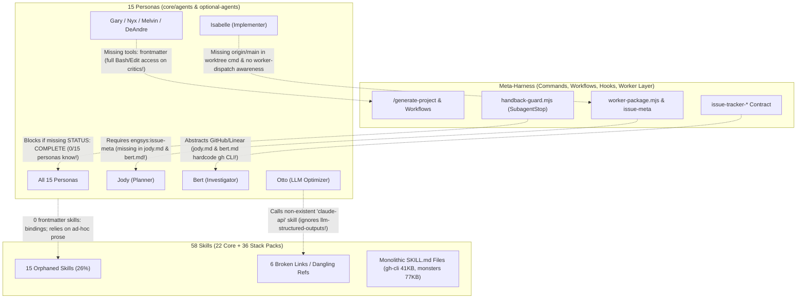

# Specification & Critical Evaluation: `engsys` Personas, Skillsets & Meta-Harness Upgrade (`v1.0.0`)

### Scope & Spec Tier Recommendation
- **Recommended Tier**: `Tier L` (Full Spec — 15 personas across `core/agents/*.md` and `optional-agents/*.md`, 58 skills across `core/skills/**` and `stacks/**`, `scripts/build-plugins.mjs`, and `lib/manifest.js`).
- **Triggered Escalation Tripwires (`TW-1..TW-6`)**:
  - `TW-1` (Data Model / Schema Migration): Standardizes persona YAML frontmatter (`name`, `description`, `model`, `tools`, `skills`), skill YAML frontmatter (`name`, `description`), and `engsys.lock` skill pruning.
  - `TW-3` (Auth / Trust Boundary / Security): Enforces read-only tool scopes (`tools: Read, Grep, Glob, Write`) on critic personas (`gary`, `melvin`, `nyx`, `leith`, `marcelo`, `otto`, `jos`, `sandy`, `deandre`), `model: haiku` + `tools: Read` on `steve`, and adds AI/Agentic & MCP security audit rules to `nyx.md`.
  - `TW-4` (Multi-PR / Cross-Subsystem): Spans 15 personas, 22 core skills, 24 stack packs (36 stack skills), `scripts/build-plugins.mjs`, and `lib/manifest.js`.
  - `TW-5` (AI / LLM / Agentic Pipeline): Refreshes `llm-structured-outputs`, `otto.md`, and `agentic-eval` for October 2026 models (`claude-sonnet-5`, `claude-opus-4-8`, `gpt-5.6-terra`, `deepseek-v4-pro`, `grok-4.5`) and structures persona/skill prompt bindings.
  - `TW-6` (Infra / CI / Deploy Topology): Updates `gcp-deployment-preflight`, `iac-terraform`, `docker-database-package-copy`, and `scripts/build-plugins.mjs --check`.
- **Harmonized Unified Epic Alignment**:
  - Implemented as **Track B** of [`engsys-unified-epic-spec.md`](file:///Users/eric/git/engineering/engsys-unified-epic-spec.md):
    - **Epic Phase 2 (`Issue #2`, shared with Track C)**: Upgrades `handback-guard.mjs`, `core/templates/settings.json.tmpl`, and `scripts/build-plugins.mjs`.
    - **Epic Phase 3 (`Issue #3`, primary Track B + Track A)**: Upgrades all 15 personas (`core/agents/*.md`, `optional-agents/*.md`) and `/design-critique` + `/design-audit`.
    - **Epic Phase 4 (`Issue #4`, primary Track B)**: Repairs, consolidates, trims (`references/`), and refreshes all core skills (`core/skills/**`).
    - **Epic Phase 5 (`Issue #5`, primary Track B)**: Adds the 8 missing `claude.fragment.md` files, strips Keystone monorepo leakage, modernizes 2026 stack skills across all 24 stack packs (`stacks/**`), and regenerates `.claude-plugin/` artifacts.
    - **Epic Phase 6 (`Issue #6`, shared with Track C & Track A)**: Wires conditional core skill pruning into `lib/manifest.js` and `CLAUDE.md.tmpl`.

**Scope Evaluated:**
- **15 Personas:** 11 core ([`core/agents/*.md`](file:///Users/eric/git/engineering/engsys/core/agents)) + 4 optional ([`optional-agents/*.md`](file:///Users/eric/git/engineering/engsys/optional-agents))
- **58 Skills:** 22 core ([`core/skills/`](file:///Users/eric/git/engineering/engsys/core/skills), ~79K tokens across 7,659 lines of `SKILL.md`) + 36 stack-pack skills across 24 packs ([`stacks/`](file:///Users/eric/git/engineering/engsys/stacks), ~127K tokens including `references/`)
- **Meta-Harness:** Installer & manifest compiler ([`lib/manifest.js`](file:///Users/eric/git/engineering/engsys/lib/manifest.js), [`lib/render.js`](file:///Users/eric/git/engineering/engsys/lib/render.js), [`lib/commands.js`](file:///Users/eric/git/engineering/engsys/lib/commands.js)), plugin marketplace generator ([`scripts/build-plugins.mjs`](file:///Users/eric/git/engineering/engsys/scripts/build-plugins.mjs)), runtime hooks ([`core/.claude-plugin/`](file:///Users/eric/git/engineering/engsys/core/.claude-plugin)), workflows ([`core/workflows/`](file:///Users/eric/git/engineering/engsys/core/workflows)), slash commands ([`core/commands/`](file:///Users/eric/git/engineering/engsys/core/commands)), and multi-provider worker dispatcher ([`core/scripts/worker-package.mjs`](file:///Users/eric/git/engineering/engsys/core/scripts/worker-package.mjs), [`core/scripts/worker-run.mjs`](file:///Users/eric/git/engineering/engsys/core/scripts/worker-run.mjs))

---

## Executive Verdict

`engsys`'s **Three-Layer Architecture** ([`docs/architecture.md`](file:///Users/eric/git/engineering/engsys/docs/architecture.md#L28-L38) — stable *Personas* in `core/agents/`, composable *Capabilities* in `stacks/**/skills/`, and repo-local *Project Facts* in `CLAUDE.md`) is an inspired foundational design. Combined with deterministic installation, `SubagentStop`/`Stop` handback guards, and cross-family worker verification, the outer skeleton is ahead of most agentic harnesses in late 2026.

However, **the inner wiring between the meta-harness, the 15 personas, and the 58 skills has drifted significantly behind the harness's own 2026 mechanisms**:
1. **The meta-harness enforces contracts that the personas do not know exist** (e.g., [`handback-guard.mjs`](file:///Users/eric/git/engineering/engsys/core/.claude-plugin/handback-guard.mjs#L85-L87) blocks any `engsys:*` subagent missing `STATUS: COMPLETE|INCOMPLETE`, yet **0 of 15 persona `.md` files** mention that footer; [`generate-project.md`](file:///Users/eric/git/engineering/engsys/core/workflows/generate-project.md#L157-L177) fails Phase 6 if issues lack `<!-- engsys:issue-meta -->`, yet [`jody.md`](file:///Users/eric/git/engineering/engsys/core/agents/jody.md#L71-L78) never mentions it).
2. **Skill binding is 100% prose-driven and 26% orphaned**: **0 of 15 personas** use frontmatter `skills:` bindings, **14 of 15** lack `tools:` restrictions (giving read-only critics like Gary, Nyx, Melvin, and DeAndre full `Edit`/`Write`/`Bash` access), **15 of 58 skills (26%) are completely unreferenced** by any persona, command, workflow, or stack fragment, and **6 skills contain broken internal file/skill links**.
3. **Several skills and persona instructions are frozen in 2024–early 2026 or leak a single monorepo's internals** (e.g., [`llm-structured-outputs`](file:///Users/eric/git/engineering/engsys/core/skills/llm-structured-outputs/SKILL.md#L28-L32) teaches Feb 2026 `claude-opus-4-6` / `gpt-5.3` while `engsys` runs Oct 2026 `claude-sonnet-5` / `claude-opus-4-8` / `gpt-5.6-terra` / `deepseek-v4-pro` / `grok-4.5`; [`mongo-conventions`](file:///Users/eric/git/engineering/engsys/stacks/db/mongo/skills/mongo-conventions/SKILL.md#L12-L28) mandates the EOL Python `motor` driver; [`react-conventions`](file:///Users/eric/git/engineering/engsys/stacks/platform/web/skills/react-conventions/SKILL.md#L38-L99) and [`frontend-testing`](file:///Users/eric/git/engineering/engsys/stacks/platform/web/skills/frontend-testing/SKILL.md#L38-L60) hardcode app-specific symbols like `useThemeGrid`, `JudgmentChip`, and `signalsExportApi`).



---

## Part 1: Critical Evaluation of How the Meta-Harness Employs Personas & Skills

### 1.1 The "Silent Hook Trap": `handback-guard.mjs` vs. Persona Definitions
- **What the harness does:** [`core/.claude-plugin/handback-guard.mjs`](file:///Users/eric/git/engineering/engsys/core/.claude-plugin/handback-guard.mjs#L85-L87) intercepts `SubagentStop` for every `engsys:*` persona and blocks the subagent (`exitCode = 2`) if its final message lacks `STATUS: COMPLETE` or `STATUS: INCOMPLETE — <what remains>`. [`core/templates/CLAUDE.md.tmpl`](file:///Users/eric/git/engineering/engsys/core/templates/CLAUDE.md.tmpl#L125) claims: *"engsys personas always end with `STATUS: COMPLETE` or `STATUS: INCOMPLETE — …`."*
- **What actually happens:** **Zero of the 15 persona files** (`core/agents/*.md`, `optional-agents/*.md`) mention `STATUS: COMPLETE` or `STATUS: INCOMPLETE`. Because subagents do not receive the parent session's full `CLAUDE.md` unless injected or read, every `engsys:*` subagent in plugin mode fails its first `SubagentStop` check, triggers a synthetic error turn, and pays a full context cache-read penalty just to output `STATUS: COMPLETE`.
- **Copy-mode parity gap:** [`core/templates/settings.json.tmpl`](file:///Users/eric/git/engineering/engsys/core/templates/settings.json.tmpl) does not wire `handback-guard.mjs` at all, so copy-mode installs silently lack the handback guard that plugin mode enforces.

### 1.2 Unbounded Tool Permissions on Advisory/Read-Only Personas
- **What the harness does:** [`core/workflows/generate-project.md`](file:///Users/eric/git/engineering/engsys/core/workflows/generate-project.md#L127) warns orchestrators: *"Also explicitly forbid long-running commands (review CLIs, the full precheck, builds): a full-tool agent will otherwise invoke them on its own, and a review CLI stuck connecting can hang until its timeout and make the agent look dead."*
- **Why this happens:** Only **1 of 15 personas** ([`patricia.md`](file:///Users/eric/git/engineering/engsys/core/agents/patricia.md#L5)) declares a `tools:` frontmatter field. Advisory, design, and critique personas — **Gary** (who *"never learned to code"* and *"does not implement fixes"*, [`gary.md`](file:///Users/eric/git/engineering/engsys/core/agents/gary.md#L3-L13)), **Nyx**, **Melvin**, **Leith**, **Marcelo**, **Otto**, **DeAndre**, **Jos**, **Sandy**, and **Steve** — inherit full `Bash`, `Edit`, `MultiEdit`, and `Write` tools. Instead of relying on fragile spawn-prompt prose ("please don't run builds"), the persona frontmatter itself should scope tool access.

### 1.3 Prose-Only Skill Discovery & Unconditional Core Skill Sprawl
- **Zero `skills:` frontmatter bindings:** None of the 15 personas declare `skills:` in their YAML frontmatter, nor does [`scripts/build-plugins.mjs`](file:///Users/eric/git/engineering/engsys/scripts/build-plugins.mjs) inject stack skill bindings into persona definitions when stack plugins are enabled. Instead, personas contain generic boilerplate: *"consult the project's active skill packs (language conventions, testing, cloud)"*.
- **Unconditional installation of all 22 core skills ([`lib/manifest.js`](file:///Users/eric/git/engineering/engsys/lib/manifest.js#L117-L122)):**
  - Every project gets `merge-monster`, `maintenance-monster`, `resource-broker`, `durable-lease`, and `agent-sessions` even when it is a solo-dev repo with no always-on fleet.
  - Every iOS, Android, CLI, or backend-only project gets `chrome-devtools`, `webapp-testing`, and `web-design-reviewer` (which depend on Playwright and Chrome DevTools MCP servers only declared in [`stacks/platform/web/settings.fragment.json`](file:///Users/eric/git/engineering/engsys/stacks/platform/web/settings.fragment.json)).
  - Every Linear project (`issue_tracker: linear`) gets `github-issues` and the 2,203-line `gh-cli` skill.
- **Missing `claude.fragment.md` in 8 stack packs:** While `cloud/*` and `iac/*` packs include a `claude.fragment.md` telling personas which skills to load, **8 stack packs lack a `claude.fragment.md` entirely**: `db/mongo`, `domain/mobile-growth`, `lang/kotlin`, `lang/python`, `lang/shell`, `lang/swift`, `lang/typescript`, and `platform/web`. In plugin mode ([`scripts/build-plugins.mjs`](file:///Users/eric/git/engineering/engsys/scripts/build-plugins.mjs#L147-L150)), a stack pack without `claude.fragment.md` generates **no `SessionStart` context hook**, so enabling `engsys-typescript@engsys`, `engsys-python@engsys`, or `engsys-web@engsys` injects zero session-start guidance!

### 1.4 Split Brain Between In-Session Personas and the Multi-Provider Worker Layer
- `engsys` has a sophisticated external worker contract ([`core/workflows/worker-dispatch.md`](file:///Users/eric/git/engineering/engsys/core/workflows/worker-dispatch.md), [`core/scripts/worker-package.mjs`](file:///Users/eric/git/engineering/engsys/core/scripts/worker-package.mjs)) where [`worker-package.mjs`](file:///Users/eric/git/engineering/engsys/core/scripts/worker-package.mjs#L130-L244) parses `<!-- engsys:issue-meta -->`, enforces `no_external`, materializes `touches` as binding churn, slices `spec_refs` (`docs/specs/foo.md#Heading`) into `contract/spec-*.md`, and injects `.claude/workflows/briefs/project-brief-overlay.md`.
- **Yet in-session personas get none of this:**
  1. When **Isabelle** or **Aaron** implements a phase in-session ([`agent-implementation-workflow.md`](file:///Users/eric/git/engineering/engsys/core/workflows/agent-implementation-workflow.md)), nothing extracts `spec_refs` sections, nothing checks `git diff --name-only` against `touches`, and nothing injects `project-brief-overlay.md` or matched lessons from `docs/agent-lessons/`.
  2. In plugin mode ([`engsys-context.mjs`](file:///Users/eric/git/engineering/engsys/core/.claude-plugin/engsys-context.mjs#L34-L55)), the multi-provider worker layer is stripped out AND `lessons-library/` (51 curated lessons) is **not bundled or seeded at all**!
  3. **Jody** ([`jody.md`](file:///Users/eric/git/engineering/engsys/core/agents/jody.md)) and **Bert** ([`bert.md`](file:///Users/eric/git/engineering/engsys/core/agents/bert.md)) have zero instructions in their persona files to emit `<!-- engsys:issue-meta -->`, so issues filed via `/file-issue` or direct Jody invocations fail `worker-package.mjs` expectations.

### 1.5 Rigid Waterfall Ceremony in `/generate-project` vs. Unstructured `/file-issue`
- As noted in [`engsys-sdd-upgrade-spec.md`](file:///Users/eric/git/engineering/engsys-sdd-upgrade-spec.md#L9-L28), the meta-harness currently forces a binary cliff: either a heavyweight 8-phase, 7-subagent waterfall ([`core/workflows/generate-project.md`](file:///Users/eric/git/engineering/engsys/core/workflows/generate-project.md#L120-L238): `Leith` + `Melvin` → `Nyx` + `Gary` → reconcile → `Marcelo` → `Jody` → `Sanity Check`) or a single-step `/file-issue` with zero architecture/security tripwires.
- Furthermore, **Aaron** (IaC/CI) and **Otto** (LLM/AI optimization) are **excluded from `/generate-project` Phase 4** ([`generate-project.md`](file:///Users/eric/git/engineering/engsys/core/workflows/generate-project.md#L53-L152)), even when a project is primarily infrastructure or an LLM pipeline! And **Gary** was added to Phase 4D ([`generate-project.md`](file:///Users/eric/git/engineering/engsys/core/workflows/generate-project.md#L141-L147)) but forgotten in Phase 1's agent read list ([`L53`](file:///Users/eric/git/engineering/engsys/core/workflows/generate-project.md#L53)) and Phase 8's Spec Quality Checklist ([`L257-L276`](file:///Users/eric/git/engineering/engsys/core/workflows/generate-project.md#L257-L276)).

---

## Part 2: Critical Evaluation of the 15 Personas

> [!WARNING]
> **7 Systemic Defects Across the Persona Roster:**
> 1. **0 / 15 personas** include the `STATUS: COMPLETE` / `STATUS: INCOMPLETE — <what remains>` footer required by [`handback-guard.mjs`](file:///Users/eric/git/engineering/engsys/core/.claude-plugin/handback-guard.mjs#L85-L87).
> 2. **0 / 15 personas** declare `skills:` in frontmatter; **14 / 15** omit `tools:` in frontmatter.
> 3. **2 personas (`jody.md`, `bert.md`)** hardcode `gh issue` / `gh project` ("No GitHub MCP server"), directly breaking the [`issue-tracker-*`](file:///Users/eric/git/engineering/engsys/stacks/tooling/issue-tracker-linear/claude.fragment.md) abstraction when Linear is used.
> 4. **Broken skill pointers:** [`otto.md:164`](file:///Users/eric/git/engineering/engsys/core/agents/otto.md#L164) points to a non-existent `claude-api` skill (ignoring [`llm-structured-outputs`](file:///Users/eric/git/engineering/engsys/core/skills/llm-structured-outputs/SKILL.md)); [`design-critique.md:36`](file:///Users/eric/git/engineering/engsys/core/commands/design-critique.md#L36) and [`design-audit.md:60`](file:///Users/eric/git/engineering/engsys/core/commands/design-audit.md#L60) (invoking Gary/Leith) point to a non-existent `design-critique` skill (actual name: [`web-design-reviewer`](file:///Users/eric/git/engineering/engsys/core/skills/web-design-reviewer/SKILL.md)).
> 5. **0 / 15 personas** mention `<!-- engsys:issue-meta -->` or external worker dispatch (`worker-package.mjs` / `worker-run.mjs`).
> 6. **30–60% persona token bloat:** Despite [`CLAUDE.md.tmpl:13`](file:///Users/eric/git/engineering/engsys/core/templates/CLAUDE.md.tmpl#L13) ("Factual tone") and [`otto.md:120`](file:///Users/eric/git/engineering/engsys/core/agents/otto.md#L120) ("This prompt is doing emotional labor it does not need to do"), persona files spend thousands of tokens on sitcom backstories, catchphrases, and stage directions (`_Cracks knuckles_`, `🍺🍺`, `🧈`).
> 7. **Outdated pre-Oct 2026 domain gaps** in Nyx (missing agentic/MCP/prompt-injection threat surfaces), Otto (missing effort controls, interleaved thinking, multi-provider routing), Aaron (missing OpenTofu & Cloudflare), and Jos (missing AdAttributionKit & 2026 DMA/external billing economics).

### Persona-by-Persona Audit Matrix

| Persona | Size & Model | Key Bugs, Contradictions & Missing Wiring | October 2026 Upgrade Prescription |
| :--- | :--- | :--- | :--- |
| **[`aaron.md`](file:///Users/eric/git/engineering/engsys/core/agents/aaron.md)**<br>*(IaC & CI/CD)* | `153L` / `7.9KB`<br>`model: sonnet` | • **Cloudflare & GCP omission ([`L11, L144`](file:///Users/eric/git/engineering/engsys/core/agents/aaron.md#L144))**: Claims "all three hyperscalers" and lists only `aws-` and `azure-deployment-preflight`, omitting `cloudflare-deployment-preflight` and `gcp-deployment-preflight`.<br>• **Missing skills**: Omits `github-actions`, `terraform-conventions`, `durable-lease`, `pre-push`.<br>• **Missing implementation & gate rules**: Aaron owns IaC/CI issues ([`jody.md:138-139`](file:///Users/eric/git/engineering/engsys/core/agents/jody.md#L138-L139)), yet lacks worktree, `tmp/` commit, `/code-review`, and GitHub operator gate (`gate-request.sh`/`gate-check.sh` per [`lessons-library/infra-merge-is-a-deploy.md`](file:///Users/eric/git/engineering/engsys/lessons-library/infra-merge-is-a-deploy.md)) rules.<br>• **Dated lore ([`L13`](file:///Users/eric/git/engineering/engsys/core/agents/aaron.md#L13))**: "Misses the Queen" + 55 lines of pub roleplay. | • Add `skills: [github-actions, pre-push, code-review]` + dynamic `<cloud>-deployment-preflight` & `iac-<tool>`.<br>• Add **OpenTofu**, **Cloudflare Wrangler**, and **OIDC workload identity / digest-pinned deploy verification**.<br>• Add worktree + `gate-check.sh` infra deploy rules + `STATUS: COMPLETE\|INCOMPLETE`. Trim pub filler by 50%. |
| **[`bert.md`](file:///Users/eric/git/engineering/engsys/core/agents/bert.md)**<br>*(Bug RCA & Filing)* | `117L` / `5.0KB`<br>`model: sonnet` | • **Hardcodes `gh issue create` ([`L49-50, L71`](file:///Users/eric/git/engineering/engsys/core/agents/bert.md#L49-L50))**: Violates `issue-tracker-*` contract on Linear.<br>• **Emoji mismatch ([`L43`](file:///Users/eric/git/engineering/engsys/core/agents/bert.md#L43))**: Uses `📝 Content:` instead of `📄 Content:` ([`issue-tracking.md:57`](file:///Users/eric/git/engineering/engsys/core/workflows/issue-tracking.md#L57)).<br>• **Incomplete issue body ([`L52-57`](file:///Users/eric/git/engineering/engsys/core/agents/bert.md#L52-L57))**: Omits Acceptance Criteria, Dependencies, Effort, Owner, `rm tmp/issue-body-*.md`, and `<!-- engsys:issue-meta -->`.<br>• **Missing `untrusted-input` skill**: Reads untrusted bug reports/logs without referencing [`untrusted-input`](file:///Users/eric/git/engineering/engsys/core/skills/untrusted-input/SKILL.md). | • Bind `skills: [untrusted-input]` and route issue creation through `issue-tracker-*`.<br>• Require `<!-- engsys:issue-meta -->` (`touches`, `risk`, `depends_on`) on every filed issue.<br>• Add **4-Tripwire Up-Tier Escalation** (`TW-1..TW-4`: escalate multi-phase or schema+auth bugs to `/design-change` Tier M).<br>• Add `lessons-library/prove-causation-before-acting.md` discipline. |
| **[`gary.md`](file:///Users/eric/git/engineering/engsys/core/agents/gary.md)**<br>*(Comprehension Critic)* | `105L` / `14.0KB`<br>`model: opus` | • **Tool over-permission**: Gary *"never learned to code"* ([`L13`](file:///Users/eric/git/engineering/engsys/core/agents/gary.md#L13)) and *"does not implement fixes"* ([`L3`](file:///Users/eric/git/engineering/engsys/core/agents/gary.md#L3)), yet has full `Edit`/`MultiEdit`/`Bash` access.<br>• **Missing skill bindings**: Mentions `interactive-explainer` (`L3, L46`), but omits `web-design-reviewer` and `chrome-devtools`.<br>• **7KB academic wall of text ([`L9-39`](file:///Users/eric/git/engineering/engsys/core/agents/gary.md#L9-L39))**: Dense prose paragraphs inflate every invocation. | • Restrict frontmatter `tools: Read, Grep, Glob, Write` (Write only for `tmp/gary-*.md` & `docs/critiques/`).<br>• Bind `skills: [web-design-reviewer, interactive-explainer, chrome-devtools]`.<br>• Compress academic biography by 50% into scannable evaluation rubrics + add `STATUS: COMPLETE\|INCOMPLETE`. |
| **[`isabelle.md`](file:///Users/eric/git/engineering/engsys/core/agents/isabelle.md)**<br>*(Implementer)* | `152L` / `8.8KB`<br>`model: sonnet` | • **Worktree bug ([`L74`](file:///Users/eric/git/engineering/engsys/core/agents/isabelle.md#L74))**: `git worktree add ../worktrees/<slug> -b agent/<slug>` **omits `origin/main`**, branching from whatever stale local branch is checked out (violating [`agent-implementation-workflow.md:75`](file:///Users/eric/git/engineering/engsys/core/workflows/agent-implementation-workflow.md#L75) and [`worktrees-need-bootstrap-from-origin-main.md`](file:///Users/eric/git/engineering/engsys/lessons-library/worktrees-need-bootstrap-from-origin-main.md)).<br>• **Contradicts co-commit rule ([`L82`](file:///Users/eric/git/engineering/engsys/core/agents/isabelle.md#L82))**: Mandates 1 commit per issue without the file-overlap co-commit exception ([`agent-implementation-workflow.md:101`](file:///Users/eric/git/engineering/engsys/core/workflows/agent-implementation-workflow.md#L101)).<br>• **Missing `claim.mjs release`, `mm:ready` handoff, `gate-check.sh`, and `touches`/`spec_refs` contract awareness**.<br>• **4× internal repetition**: Repeats the same 6 rules in `Your Role`, `Workflow`, `CRITICAL rules`, and `Do/Don't`. | • Fix `L74` worktree command to append `origin/main`; add `claim.mjs release` and file-overlap co-commit rule.<br>• Bind `skills: [code-review, pre-push, git-workflow-agents, refactor]`.<br>• Add Merge Monster (`mm:ready` draft handoff), `touches` scope check, and `STATUS: COMPLETE\|INCOMPLETE`. Deduplicate the 4 repeated lists (~35% token reduction). |
| **[`jody.md`](file:///Users/eric/git/engineering/engsys/core/agents/jody.md)**<br>*(Project Planner)* | `168L` / `9.0KB`<br>`model: opus` | • **CRITICAL: Missing `engsys:issue-meta` ([`L71-78`](file:///Users/eric/git/engineering/engsys/core/agents/jody.md#L71-L78))**: [`generate-project.md:157-177`](file:///Users/eric/git/engineering/engsys/core/workflows/generate-project.md#L157-L177) fails Phase 6 if Jody's issues lack `<!-- engsys:issue-meta -->` or the `Part of [<project>] · spec:` line ([`L24`](file:///Users/eric/git/engineering/engsys/core/workflows/generate-project.md#L24)), yet `jody.md` mentions neither!<br>• **Hardcodes `gh` CLI ([`L44, L54-56, L68`](file:///Users/eric/git/engineering/engsys/core/agents/jody.md#L44))**: Breaks `issue-tracker-linear`.<br>• **Workflow contradiction ([`L38`](file:///Users/eric/git/engineering/engsys/core/agents/jody.md#L38))**: Tells Jody to pause and ask user confirmation before creating issues, whereas `/generate-project` Phase 4G spawns Jody to create the board & issues autonomously.<br>• **Incomplete Ownership Matrix ([`L134-146`](file:///Users/eric/git/engineering/engsys/core/agents/jody.md#L134-L146))**: Omits Gary, Sandy, Jos, DeAndre, and `📄 Content:` title format. | • Add mandatory `<!-- engsys:issue-meta -->` schema, `Part of [...] · spec:` context line, and placeholder/call-site grep rules from `generate-project.md:23-27` directly into `jody.md`.<br>• Replace hardcoded `gh` commands with `issue-tracker-*` operations.<br>• Update Ownership Matrix and distinguish interactive vs. Phase 4G subagent mode. |
| **[`leith.md`](file:///Users/eric/git/engineering/engsys/core/agents/leith.md)**<br>*(Product & UX)* | `123L` / `8.1KB`<br>`model: opus` | • **Spec template collision ([`L55-67`](file:///Users/eric/git/engineering/engsys/core/agents/leith.md#L55-L67) vs. [`generate-project.md:79-131`](file:///Users/eric/git/engineering/engsys/core/workflows/generate-project.md#L79-L131))**: Tells Leith to overwrite `docs/specs/<slug>.md` with an 8-section standalone template instead of writing `## Product and UX Specification` to `tmp/leith-<topic>.md`.<br>• **Missing skill bindings**: Mentions `swiftui-patterns` and `jetpack-compose`, but omits `web-platform-conventions`, `react-conventions`, `web-design-reviewer`, and `interactive-explainer`. | • Align spec output with `generate-project.md` (`tmp/leith-<topic>.md` when in design loop; structured state table for empty/loading/error/partial/permission-denied states).<br>• Bind `skills: [web-design-reviewer, interactive-explainer]`.<br>• Restrict `tools: Read, Grep, Glob, Write` + add `STATUS: COMPLETE\|INCOMPLETE`. |
| **[`marcelo.md`](file:///Users/eric/git/engineering/engsys/core/agents/marcelo.md)**<br>*(Testing Strategist)* | **`296L` / `19.8KB`**<br>`model: opus` | • **Largest persona file (19.8KB)**: Contains ~150 lines of static textbook tables.<br>• **Stale artifact path ([`L240-269`](file:///Users/eric/git/engineering/engsys/core/agents/marcelo.md#L240-L269))**: Instructs Marcelo to write `docs/{sprint}/testing-strategy.md` (`**Sprint**: d2`), contradicting `engsys`'s phase-based `docs/specs/<slug>.md` (`tmp/marcelo-<topic>.md`).<br>• **Copy-paste voice leak ([`L80`](file:///Users/eric/git/engineering/engsys/core/agents/marcelo.md#L80))**: Calls the user `"Honey,"` (Jody/Patricia's voice).<br>• **Missing skill bindings**: Only mentions `agentic-eval` ([`L201`](file:///Users/eric/git/engineering/engsys/core/agents/marcelo.md#L201)); omits `webapp-testing`, `hermetic-git-tests`, `untrusted-input`, `frontend-testing`, `swift-testing`, `android-testing`. | • Cut `marcelo.md` from `296L` to `~120L` by extracting static testing tables into `core/skills/testing-strategy/references/`.<br>• Replace `docs/{sprint}/testing-strategy.md` with `docs/specs/<slug>.md` (`## Testing Strategy` + executable **Contract Test Table** mapping `Case ID → Input → Expected Invariant → Test File`).<br>• Fix `"Honey"` typo; bind `agentic-eval`, `webapp-testing`, `hermetic-git-tests`, `untrusted-input`. |
| **[`melvin.md`](file:///Users/eric/git/engineering/engsys/core/agents/melvin.md)**<br>*(Cloud Architect)* | `102L` / `6.2KB`<br>`model: opus` | • **Omits Cloudflare & DB packs ([`L96`](file:///Users/eric/git/engineering/engsys/core/agents/melvin.md#L96))**: Lists `cloud-architecture-{aws,azure,gcp}`, omitting `cloud-architecture-cloudflare`, `azure-resource-visualizer`, `microsoft-docs`, `prisma-conventions`, and `mongo-conventions`.<br>• **Prose-only spec output**: Doesn't require fenced TypeScript/SQL/Prisma/API contract blocks needed by `worker-package.mjs` `spec_refs` slicing. | • Add `cloud-architecture-cloudflare`, `azure-resource-visualizer`, `microsoft-docs`, and DB pack references.<br>• Require **Executable Contract Blocks** (explicit TS interfaces, Prisma/SQL DDL, route/event schemas under `### <Section>` anchors) in `## Architecture Specification`.<br>• Restrict `tools: Read, Grep, Glob, Write` + add `STATUS: COMPLETE\|INCOMPLETE`. |
| **[`nyx.md`](file:///Users/eric/git/engineering/engsys/core/agents/nyx.md)**<br>*(Offensive Security)* | `154L` / `8.0KB`<br>`model: opus` | • **Model classifier vulnerability ([`L4`](file:///Users/eric/git/engineering/engsys/core/agents/nyx.md#L4) vs. [`CLAUDE.md.tmpl:27`](file:///Users/eric/git/engineering/engsys/core/templates/CLAUDE.md.tmpl#L27))**: Uses `model: opus` without documenting that the session environment must pin `ANTHROPIC_DEFAULT_OPUS_MODEL` to a non-classifier model (`claude-opus-4-8` via `security.env`, since `Agent.model` rejects full IDs in Claude Code `2.1.285`).<br>• **Zero 2026 AI/Agentic threat surface ([`L78-88`](file:///Users/eric/git/engineering/engsys/core/agents/nyx.md#L78-L88))**: Covers LDAP/SQLi/XSS but omits indirect prompt injection, `untrusted.mjs` envelope spoofing, MCP tool poisoning / confused deputy, and cross-tenant RAG/vector leaks.<br>• **Missing skill bindings**: Omits `untrusted-input` and `github-actions`. | • Add **AI / Agentic & MCP Security** row to Offensive/Defensive tables and bind `skills: [untrusted-input, github-actions, code-review]`.<br>• Require **Negative Security Assertions** (`Given caller in Tenant A and resource in Tenant B → MUST return 403/404 with 0 side effects`) in specs.<br>• Document `security.env` alias pinning (`ANTHROPIC_DEFAULT_OPUS_MODEL`) + `STATUS: COMPLETE\|INCOMPLETE`. |
| **[`otto.md`](file:///Users/eric/git/engineering/engsys/core/agents/otto.md)**<br>*(LLM Optimizer)* | `171L` / `6.6KB`<br>`model: opus` | • **Broken skill reference ([`L164`](file:///Users/eric/git/engineering/engsys/core/agents/otto.md#L164))**: Instructs Otto to *"use the `claude-api` skill as the source of truth"* — **`claude-api` does not exist**! Meanwhile, [`llm-structured-outputs`](file:///Users/eric/git/engineering/engsys/core/skills/llm-structured-outputs/SKILL.md) and [`agentic-eval`](file:///Users/eric/git/engineering/engsys/core/skills/agentic-eval/SKILL.md) are never referenced in `otto.md`.<br>• **Excluded from `/generate-project`**: Never consulted during Phase 4 when designing AI/LLM features.<br>• **Missing Oct 2026 LLM primitives**: Omits reasoning effort (`low`/`medium`/`high`/`xhigh` vs. tier escalation), prompt cache prefix ordering & TTL math, Batch API, and `engsys` multi-provider worker routing.<br>• **Ironic bloat**: 171 lines with duplicate catchphrases (`L118/122` repeated at `L170`). | • Fix `L164`: replace non-existent `claude-api` with `skills: [llm-structured-outputs, agentic-eval, untrusted-input]`.<br>• Add **2026 Reasoning Effort vs. Model Tiering**, **Prompt Cache Prefix Discipline**, and **Multi-Provider Worker Routing** (`Codex GPT-5.6`, `DeepSeek V4`, `Grok 4.5`, `Claude 5`).<br>• Wire Otto into `/generate-project` (`TW-5: AI/LLM Pipeline`) and compress `otto.md` by 40%. |
| **[`patricia.md`](file:///Users/eric/git/engineering/engsys/core/agents/patricia.md)**<br>*(Project Librarian)* | `285L` / `12.8KB`<br>`model: sonnet` | • **Self-contradicting git rules ([`L276-279`](file:///Users/eric/git/engineering/engsys/core/agents/patricia.md#L276-L279))**: Sentence 1 says she does NOT run `git commit`/`git push`; Sentence 2 ("Going forward...") reverses it.<br>• **Conflicting & duplicated ADR template ([`L71-128`](file:///Users/eric/git/engineering/engsys/core/agents/patricia.md#L71-L128) vs. [`review-workflow.md:219-244`](file:///Users/eric/git/engineering/engsys/core/workflows/review-workflow.md#L219-L244))**: Duplicates 57 lines from [`core/templates/adr-template.md`](file:///Users/eric/git/engineering/engsys/core/templates/adr-template.md), which conflicts with `/prep-review-finalize`'s ADR format.<br>• **Not wired into `/prep-review-finalize` or `/project-closeout`**. | • Deduplicate `L71-128` by pointing to `<engsys-root>/templates/adr-template.md` and unifying with `review-workflow.md`.<br>• Resolve the `L276-279` git contradiction; add `reconcile-the-whole-doc-when-flipping-status` and `docs/specs/` lifecycle reconciliation (`draft → active → shipped → archived`).<br>• Bind `skills: [interactive-explainer, git-commit]`. |
| **[`deandre.md`](file:///Users/eric/git/engineering/engsys/optional-agents/deandre.md)**<br>*(Optional: Tutor)* | `146L` / `8.9KB`<br>`model: sonnet` | • **Unlisted in `README.md:252` & `docs/architecture.md:128-132`**.<br>• **Over-permissioned**: Explicitly forbidden from writing code or managing tasks ([`L21-25`](file:///Users/eric/git/engineering/engsys/optional-agents/deandre.md#L21-L25)), yet lacks `tools: Read, Grep, Glob`.<br>• **4× structural repetition** of his 7-section output format and missing full team roster. | • Add `tools: Read, Grep, Glob` (or `Write` for `interactive-explainer` HTML artifacts), bind `skills: [interactive-explainer]`, add full team roster, and list DeAndre in `README.md` / `docs/architecture.md`. |
| **[`jos.md`](file:///Users/eric/git/engineering/engsys/optional-agents/jos.md)**<br>*(Optional: Growth/Monetization)* | `137L` / `8.5KB`<br>`model: opus` | • **Dated attribution terminology ([`L9, L42, L55`](file:///Users/eric/git/engineering/engsys/optional-agents/jos.md#L42))**: Cites `SKAdNetwork` without Apple's **AdAttributionKit** or 2025–2026 EU DMA / US external-link fee structures.<br>• **Missing `Your Team` section** (no link to Sandy, Leith, Gary, Jody). | • Bind `skills: [apple-ads, google-play-growth]`, update for **AdAttributionKit** + 2026 alternative billing economics, add `Your Team` section, and restrict `tools: Read, Grep, Glob, Write`. |
| **[`sandy.md`](file:///Users/eric/git/engineering/engsys/optional-agents/sandy.md)**<br>*(Optional: Marketing/SEO)* | `102L` / `11.9KB`<br>`model: opus` | • **Missing `interactive-explainer` back-link**: [`interactive-explainer/SKILL.md:56`](file:///Users/eric/git/engineering/engsys/core/skills/interactive-explainer/SKILL.md#L56) delegates copy passes to Sandy, but `sandy.md` never mentions `interactive-explainer` or `web-design-reviewer`.<br>• Omits **Gary** and **Jos** from `Your Team` ([`L86-93`](file:///Users/eric/git/engineering/engsys/optional-agents/sandy.md#L86-L93)). | • Bind `skills: [interactive-explainer, web-design-reviewer, web-platform-conventions]`, add Gary and Jos to `Your Team`, and trim the 2.5KB agency backstory. |
| **[`steve.md`](file:///Users/eric/git/engineering/engsys/optional-agents/steve.md)**<br>*(Optional: Scapegoat)* | `162L` / `4.4KB`<br>`model: sonnet` | • Comic-relief persona with full `Edit`/`Write`/`Bash` permissions and `model: sonnet` (could be `haiku` / `tools: Read`). | • Add `tools: Read` and `STATUS: COMPLETE` so invoking Steve for a joke can never mutate files or trip `handback-guard.mjs`. |

---

## Part 3: Critical Evaluation of the 58 Skills (`core/skills/` & `stacks/`)

### 3.1 Broken Links, Dangling Skill Names & Unreferenced Files (Immediate Bugs)

| Location | Defect | Impact & Fix |
| :--- | :--- | :--- |
| **[`core/skills/github-issues/SKILL.md:17, 46`](file:///Users/eric/git/engineering/engsys/core/skills/github-issues/SKILL.md#L17)** | Links to `[references/templates.md](references/templates.md)`, which **does not exist** (`core/skills/github-issues/` has no `references/` dir). | Agents fail with `ENOENT` when trying to read issue templates. Point to `<engsys-root>/templates/gh-issue-templates/` or retire `github-issues` into `issue-tracker-github`. |
| **[`core/skills/web-design-reviewer/SKILL.md:175, 179, 193`](file:///Users/eric/git/engineering/engsys/core/skills/web-design-reviewer/SKILL.md#L175)** | • `L193` links to non-existent `[references/framework-fixes.md](references/framework-fixes.md)`.<br>• `L175, L179` instruct agents to call Cursor/Windsurf tools `grep_search` and `semantic_search` instead of `Grep`/`Glob`. | Create `references/framework-fixes.md` (or inline/remove the broken link) and replace `grep_search`/`semantic_search` with `Grep`/`Glob`. |
| **[`stacks/lang/swift/skills/swiftui-patterns/SKILL.md:26, 289`](file:///Users/eric/git/engineering/engsys/stacks/lang/swift/skills/swiftui-patterns/SKILL.md#L26)**<br>+ [`architecture-patterns.md:380`](file:///Users/eric/git/engineering/engsys/stacks/lang/swift/skills/swiftui-patterns/references/architecture-patterns.md#L380)<br>+ [`design-polish.md:168`](file:///Users/eric/git/engineering/engsys/stacks/lang/swift/skills/swiftui-patterns/references/design-polish.md#L168) | Delegates navigation, layout, and animation to **3 non-existent skills**: `swiftui-navigation`, `swiftui-layout-components`, and `swiftui-animation`. Also contains 10 third-party `https://sosumi.ai/documentation/...` links. | Add `references/navigation-and-layout.md` inside `swiftui-patterns` (or ship the missing reference files) and rewrite the 3 dangling skill pointers + replace `sosumi.ai` URLs with `developer.apple.com`. |
| **[`core/skills/refactor/SKILL.md:3`](file:///Users/eric/git/engineering/engsys/core/skills/refactor/SKILL.md#L3)** | Frontmatter `description` says: *"Less drastic than repo-rebuilder; use for gradual improvements."* No `repo-rebuilder` exists in `engsys`. | Remove the dangling `repo-rebuilder` reference. |
| **[`core/skills/git-workflow-agents/SKILL.md:469`](file:///Users/eric/git/engineering/engsys/core/skills/git-workflow-agents/SKILL.md#L469)** | Relative link `[CLAUDE.md](../../../CLAUDE.md)` breaks in `engsys` source and in plugin-mode cache paths. | Replace with `` `CLAUDE.md` (at the repository root) ``. |
| **[`core/skills/webapp-testing/test-helper.js`](file:///Users/eric/git/engineering/engsys/core/skills/webapp-testing/test-helper.js)** | 57-line CommonJS helper shipped beside [`webapp-testing/SKILL.md`](file:///Users/eric/git/engineering/engsys/core/skills/webapp-testing/SKILL.md), which **never mentions it** and uses inline ESM instead. | Either reference and modernize `test-helper.js` to ESM or delete it. |
| **[`core/commands/design-critique.md:36`](file:///Users/eric/git/engineering/engsys/core/commands/design-critique.md#L36)** & **[`design-audit.md:60`](file:///Users/eric/git/engineering/engsys/core/commands/design-audit.md#L60)** | Instruct the agent to *"Use the `design-critique` skill as the engine if available."* No `design-critique` skill exists (the core skill is `web-design-reviewer`). | Update both commands to reference `web-design-reviewer` (or create a dedicated `design-critique` skill). |

### 3.2 Direct Contradictions Across Skills & Stack Fragments

1. **The HEREDOC War (`tmp/` File Rule vs. `cat <<'EOF'` Examples):**
   - [`CLAUDE.md.tmpl:71`](file:///Users/eric/git/engineering/engsys/core/templates/CLAUDE.md.tmpl#L71), [`git-workflow-agents/SKILL.md:278`](file:///Users/eric/git/engineering/engsys/core/skills/git-workflow-agents/SKILL.md#L278), and [`issue-tracker-github/SKILL.md:21-33`](file:///Users/eric/git/engineering/engsys/stacks/tooling/issue-tracker-github/skills/issue-tracker-github/SKILL.md#L21-L33) enforce a strict ban: **"NEVER use HEREDOC or pipes for commit messages, PR bodies, or issue content."**
   - Yet [`core/skills/git-commit/SKILL.md:100-107`](file:///Users/eric/git/engineering/engsys/core/skills/git-commit/SKILL.md#L100-L107) teaches `git commit -m "$(cat <<'EOF' ... EOF)"` and [`core/skills/gh-cli/SKILL.md:2033-2038`](file:///Users/eric/git/engineering/engsys/core/skills/gh-cli/SKILL.md#L2033-L2038) teaches `gh pr create --body "$(cat <<'EOF' ... EOF)"`!
2. **Next.js 16 `proxy.ts` vs. `middleware.ts` Inside the Same `platform/web` Pack:**
   - [`stacks/platform/web/skills/web-platform-conventions/SKILL.md:45-51`](file:///Users/eric/git/engineering/engsys/stacks/platform/web/skills/web-platform-conventions/SKILL.md#L45-L51) and [`post-edit-reminders.web.sh:6-8`](file:///Users/eric/git/engineering/engsys/stacks/platform/web/hooks/post-edit-reminders.web.sh#L6-L8) state: *"Next.js 16 replaced `middleware.ts` with `proxy.ts`... Rule: on Next.js 16+, there is no `middleware.ts` anywhere in the service."*
   - Yet its sibling skill in the very same pack, [`stacks/platform/web/skills/react-conventions/SKILL.md:191-211`](file:///Users/eric/git/engineering/engsys/stacks/platform/web/skills/react-conventions/SKILL.md#L191-L211) (targeting React 19 / Next.js 16 at `L3, L8`), has a 20-line section teaching how to write `middleware.ts` for the Next.js Edge Runtime!
3. **GitHub MCP Ban vs. GitHub MCP Fallback:**
   - [`CLAUDE.md.tmpl:95`](file:///Users/eric/git/engineering/engsys/core/templates/CLAUDE.md.tmpl#L95) and [`stacks/tooling/issue-tracker-github/claude.fragment.md:6-8`](file:///Users/eric/git/engineering/engsys/stacks/tooling/issue-tracker-github/claude.fragment.md#L6-L8) state: **`"gh only — no GitHub MCP server."`**
   - Yet [`core/skills/github-issues/SKILL.md:3, 99-114`](file:///Users/eric/git/engineering/engsys/core/skills/github-issues/SKILL.md#L99-L114) teaches falling back to `mcp__github__issue_write` / `mcp__github__list_issues`, and [`issue-tracker-github/SKILL.md:289`](file:///Users/eric/git/engineering/engsys/stacks/tooling/issue-tracker-github/skills/issue-tracker-github/SKILL.md#L289) points agents to `github-issues` for *"MCP fallback"*!
4. **`issue-tracker-github` Self-Contradiction on `gh project field-create`:**
   - [`issue-tracker-github/SKILL.md:113-120`](file:///Users/eric/git/engineering/engsys/stacks/tooling/issue-tracker-github/skills/issue-tracker-github/SKILL.md#L113-L120) uses `gh project field-create ... --single-select-options`, and then at [`L256-267`](file:///Users/eric/git/engineering/engsys/stacks/tooling/issue-tracker-github/skills/issue-tracker-github/SKILL.md#L256-L267) says *"ProjectV2 single-select fields are GraphQL-only — there's no `gh` shortcut to add a single-select field with options"* (conflating field *creation* with *adding options to an existing field*).
5. **`issue-tracker-linear` MCP Tool Prefix & Parameter Contradiction:**
   - [`issue-tracker-linear/SKILL.md:13`](file:///Users/eric/git/engineering/engsys/stacks/tooling/issue-tracker-linear/skills/issue-tracker-linear/SKILL.md#L13) says tools are prefixed `mcp__claude_ai_Linear__`, whereas [`stacks/tooling/issue-tracker-linear/.mcp.json`](file:///Users/eric/git/engineering/engsys/stacks/tooling/issue-tracker-linear/.mcp.json) registers the server as `"linear"` (which prefixes tools as `mcp__linear__`). And `L106` uses `save_project(teamId:)` while `L109` uses `save_project(teams: ["ABC"])`.
6. **`llm-structured-outputs` Self-Contradiction on Deprecated `output_format`:**
   - [`llm-structured-outputs/SKILL.md:58, 294`](file:///Users/eric/git/engineering/engsys/core/skills/llm-structured-outputs/SKILL.md#L58) warns that `output_format` is deprecated in favor of `output_config.format`, yet [`L228-234`](file:///Users/eric/git/engineering/engsys/core/skills/llm-structured-outputs/SKILL.md#L228-L234) and [`references/provider-details.md:35-40`](file:///Users/eric/git/engineering/engsys/core/skills/llm-structured-outputs/references/provider-details.md#L35-L40) still pass `output_format: MySchema` to `anthropic.messages.parse()`.

### 3.3 Severe Project-Specific Monorepo Leakage in Stack Packs
Four stack skills were lifted from a single product monorepo ("Insights" / Keystone) without generalizing domain names or file paths:
- **[`stacks/platform/web/skills/react-conventions/SKILL.md`](file:///Users/eric/git/engineering/engsys/stacks/platform/web/skills/react-conventions/SKILL.md#L38-L99)**: References `rec.themeImpactId`, `rec.decidedSuggestions`, `IMPACT_STATUS_RANK`, `useSubscriptionInvoices`, `JudgmentChip`, `SignalExportResult`, and `/api/proxy/api/v1/signals/export`.
- **[`stacks/platform/web/skills/frontend-testing/SKILL.md`](file:///Users/eric/git/engineering/engsys/stacks/platform/web/skills/frontend-testing/SKILL.md#L38-L60)**: References `signalsExportApi`, `services/dashboard`, `@/lib/access`, `INGESTION_E2E`, `useThemeGrid`, `services-ci.yml`, `all-themes-grid`, `widget-config-panel`, and `"Insights"`.
- **[`stacks/db/prisma/skills/docker-database-package-copy/SKILL.md`](file:///Users/eric/git/engineering/engsys/stacks/db/prisma/skills/docker-database-package-copy/SKILL.md#L8-L45)**: Hardcodes `services/database/index.ts`, `services/database/types.ts`, and `services/*/Dockerfile`, and is **100% duplicated verbatim** inside [`stacks/db/prisma/claude.fragment.md:31-51`](file:///Users/eric/git/engineering/engsys/stacks/db/prisma/claude.fragment.md#L31-L51) (just as [`prisma-conventions/SKILL.md`](file:///Users/eric/git/engineering/engsys/stacks/db/prisma/skills/prisma-conventions/SKILL.md) is 100% duplicated verbatim in [`stacks/db/prisma/claude.fragment.md:8-30`](file:///Users/eric/git/engineering/engsys/stacks/db/prisma/claude.fragment.md#L8-L30)!).
- **[`stacks/db/mongo/skills/mongo-conventions/SKILL.md`](file:///Users/eric/git/engineering/engsys/stacks/db/mongo/skills/mongo-conventions/SKILL.md#L45-L64)**: Hardcodes a `content_raw` collection with `(source, content_id)` unique index, `speaker`, and `published_at`.

### 3.4 Pre-October 2026 Outdated Technical Content in Skills
1. **[`core/skills/llm-structured-outputs/SKILL.md`](file:///Users/eric/git/engineering/engsys/core/skills/llm-structured-outputs/SKILL.md#L8-L33)** (Stamped `February 23, 2026`):
   - Hardcodes `claude-opus-4-6` / `claude-sonnet-4-6`, `gpt-5.3`, `gemini-3.1-pro-preview`, and `grok-4-0709`.
   - Must be updated to match `engsys`'s October 2026 model catalog ([`lib/render.js:72-77`](file:///Users/eric/git/engineering/engsys/lib/render.js#L72-L77)): **Claude Sonnet 5 / Opus 4.8 / Fable 5**, **OpenAI GPT-5.6 (`gpt-5.6-terra`, `gpt-5.6-sol`)**, **DeepSeek V4 (`deepseek-v4-flash`, `deepseek-v4-pro`)**, **xAI Grok 4.5 (`grok-4.5`)**, and **Gemini 3.5 / 4**.
2. **[`stacks/db/mongo/skills/mongo-conventions/SKILL.md:3, 12-28`](file:///Users/eric/git/engineering/engsys/stacks/db/mongo/skills/mongo-conventions/SKILL.md#L12-L28)**:
   - Mandates Python's `motor` (`AsyncIOMotorClient`), which reached **official EOL in May 2026** (replaced by `pymongo.AsyncMongoClient`), and lacks TypeScript/Node MongoDB conventions despite `db/mongo` being language-independent.
3. **[`stacks/cloud/gcp/skills/gcp-deployment-preflight/SKILL.md:3, 18-29, 58-73, 96`](file:///Users/eric/git/engineering/engsys/stacks/cloud/gcp/skills/gcp-deployment-preflight/SKILL.md#L58-L73)**:
   - Teaches `gcloud deployment-manager` (**sunset March 2026**, replaced by Infrastructure Manager / Terraform) and legacy `gsutil ls -b` (replaced by `gcloud storage`).
4. **[`stacks/platform/android/skills/android-build-conventions/SKILL.md:60-67, 102-105`](file:///Users/eric/git/engineering/engsys/stacks/platform/android/skills/android-build-conventions/SKILL.md#L60-L67)**:
   - Pins 2024 versions (`compileSdk = 35` / `targetSdk = 35`, `agp = "8.7.0"`, `kotlin = "2.1.0"`, `composeBom = "2025.01.00"`), whereas Google Play requires **API 36 (Android 16+)** in October 2026, AGP 9.x / Kotlin 2.2+ / Compose BOM 2026.x, and is **completely forgotten** in [`stacks/platform/android/claude.fragment.md`](file:///Users/eric/git/engineering/engsys/stacks/platform/android/claude.fragment.md)!
5. **[`stacks/lang/python/skills/python-conventions/SKILL.md:59`](file:///Users/eric/git/engineering/engsys/stacks/lang/python/skills/python-conventions/SKILL.md#L59)**:
   - Toy 62-line file that puts `import math` inside a function body right after citing PEP 8, and omits modern 2026 Python tooling (`uv`, `ruff`, `pyright`/`ty`, `pydantic` v2, `pytest` fixtures).

### 3.5 Token Bloat & Missing Progressive Disclosure in Core Skills
- **[`core/skills/gh-cli/SKILL.md`](file:///Users/eric/git/engineering/engsys/core/skills/gh-cli/SKILL.md)** (`2,203 lines` / `40.9 KB` / `~10.5K tokens`): A single monolithic dump of `gh` manpages (`codespace`, `gist`, `gpg-key`, `ssh-key`, `extension`). Should be replaced by a `<120-line` recipes hub (covering only non-obvious GraphQL pagination, `gh api` jq patterns, and workflow run debugging) with rare subcommands moved to `references/` or deleted.
- **[`core/skills/merge-monster/SKILL.md`](file:///Users/eric/git/engineering/engsys/core/skills/merge-monster/SKILL.md)** (`660 lines` / `41.6 KB`) and **[`core/skills/maintenance-monster/SKILL.md`](file:///Users/eric/git/engineering/engsys/core/skills/maintenance-monster/SKILL.md)** (`548 lines` / `35.4 KB`): Duplicate ~200 lines of shared baton/gate/liveness/messaging/context prose. Extract shared mechanics to `references/` and keep each `SKILL.md` under `200 lines` (`~8 KB`) so cold starts and compactions don't pay a 40KB read tax.
- **[`core/skills/refactor/SKILL.md`](file:///Users/eric/git/engineering/engsys/core/skills/refactor/SKILL.md)** (`646 lines` / `16.9 KB`): Move the 420 lines of textbook refactoring examples (`L56-481`) into `references/catalog.md`, leaving a tight 120-line operational checklist in `SKILL.md`.

---

## Part 4: Adaptive SDD Specification (`Tier L`) — Personas, Skillsets & Meta-Harness Upgrade

### Goal & Non-Goals

#### Goals
1. **Contract-Aligned Personas (15 Personas)**: Equip all 11 core personas (`core/agents/*.md`) and 4 optional personas (`optional-agents/*.md`) with:
   - Explicit YAML frontmatter (`name`, `description`, `model`, `tools`, `skills`).
   - Least-privilege `tools:` scopes (read-only critics cannot invoke `Bash` or `Edit`; `steve` runs on `model: haiku` with `tools: Read`).
   - Mandatory `## Handback Protocol` (`STATUS: COMPLETE` | `STATUS: INCOMPLETE — <what remains>`), enforced in both plugin mode and copy mode (`core/templates/settings.json.tmpl`).
   - Direct wiring to the Adaptive SDD and Fleet contracts (`<!-- engsys:issue-meta -->` in `jody.md` and `bert.md`; `origin/main` worktree base, co-commit overlap rule, `claim.mjs`, and `mm:ready` in `isabelle.md`; executable contract blocks in `melvin.md`, `nyx.md`, `marcelo.md`, `otto.md`, `aaron.md`).
2. **Broken Link & Contradiction Elimination**: Fix all 6 broken skill/command references (`github-issues`, `web-design-reviewer`, `design-critique.md`, `design-audit.md`, `swiftui-patterns`, `otto.md`) and all 3 direct rule contradictions (HEREDOC in `git-commit`/`gh-cli`, `mcp__github__` in `github-issues`, Next.js `middleware.ts` vs. `proxy.ts` in `react-conventions`).
3. **Skill Library Consolidation & Conditional Pruning (`58 → 55` Skills)**:
   - Consolidate `core/skills/git-commit` into `core/skills/git-workflow-agents`.
   - Consolidate `core/skills/github-issues` into `stacks/tooling/issue-tracker-github` and conditionally omit `gh-cli` on `issue_tracker: linear` (non-GitHub) installs via `lib/manifest.js`.
   - Consolidate `core/skills/terraform-conventions` into `stacks/iac/terraform/skills/iac-terraform`.
4. **Progressive Disclosure & Token Compression (`>65%` Cold-Load Reduction)**: Extract reference catalogs from `gh-cli`, `merge-monster`, `maintenance-monster`, `refactor`, and `marcelo.md` into `references/*.md` so every `SKILL.md` is `<200` lines.
5. **Complete Stack Pack Wiring (`24/24` Packs with `claude.fragment.md`) & De-Leaking**: Add `claude.fragment.md` to the 8 silent stack packs (`lang/typescript`, `lang/python`, `lang/shell`, `lang/swift`, `lang/kotlin`, `platform/web`, `db/mongo`, `domain/mobile-growth`), deduplicate `db/prisma/claude.fragment.md`, strip Keystone monorepo identifiers (`useThemeGrid`, `JudgmentChip`, `signalsExportApi`, `content_raw`, `services/database/index.ts`), and modernize `llm-structured-outputs`, `mongo-conventions`, `gcp-deployment-preflight`, `android-build-conventions`, and `python-conventions` for October 2026.

#### Non-Goals
- Changing persona tier aliases (`opus`, `sonnet`, `haiku`) into raw model IDs inside `core/agents/*.md` — Claude Code `2.1.285`'s `Agent` tool requires tier aliases and resolves concrete model IDs via `ANTHROPIC_DEFAULT_*_MODEL` (while `lib/render.js` translates frontmatter for Antigravity `.agents/agents/*.md` in Epic Phase 6).
- Inventing new stack packs beyond the 24 existing packs in `stacks/`.

---

### Architecture Specification (`Melvin`)

#### 1. Canonical Persona Frontmatter & Handback Schema (`core/agents/*.md`, `optional-agents/*.md`)

```ts
// Executable Contract: Persona Frontmatter & Handback Schema
export type PersonaModelTier = "opus" | "sonnet" | "haiku";

export type PersonaTool =
  | "Read"
  | "Grep"
  | "Glob"
  | "Write"
  | "Edit"
  | "Bash";

export interface PersonaFrontmatterContract {
  name: string;                    // Matches filename stem (e.g., "melvin", "nyx", "isabelle")
  description: string;             // Single-line role trigger summary
  model: PersonaModelTier;         // "opus" | "sonnet" | "haiku" (steve = "haiku")
  tools: PersonaTool[];            // Explicit least-privilege tool allowlist
  skills: string[];                // Canonical core skill names bound to this persona
}
```

| Persona | File | `model` | `tools` | `skills` |
|---|---|---|---|---|
| **Gary** | `core/agents/gary.md` | `opus` | `Read, Grep, Glob, Write` | `web-design-reviewer, interactive-explainer, chrome-devtools` |
| **Melvin** | `core/agents/melvin.md` | `opus` | `Read, Grep, Glob, Write` | `durable-lease, resource-broker` |
| **Nyx** | `core/agents/nyx.md` | `claude-opus-4-8` (`security: true`) | `Read, Grep, Glob, Write` | `untrusted-input, github-actions, code-review` |
| **Leith** | `core/agents/leith.md` | `opus` | `Read, Grep, Glob, Write` | `web-design-reviewer, interactive-explainer` |
| **Isabelle** | `core/agents/isabelle.md` | `sonnet` | `Read, Grep, Glob, Edit, Write, Bash` | `code-review, pre-push, git-workflow-agents, refactor` |
| **Marcelo** | `core/agents/marcelo.md` | `opus` | `Read, Grep, Glob, Write` | `agentic-eval, webapp-testing, hermetic-git-tests, untrusted-input` |
| **Aaron** | `core/agents/aaron.md` | `sonnet` | `Read, Grep, Glob, Edit, Write, Bash` | `github-actions, pre-push, code-review` |
| **Patricia** | `core/agents/patricia.md` | `sonnet` | `Read, Grep, Glob, Edit, Write, Bash` | `interactive-explainer, git-workflow-agents` |
| **Bert** | `core/agents/bert.md` | `sonnet` | `Read, Grep, Glob, Edit, Write, Bash` | `untrusted-input` |
| **Jody** | `core/agents/jody.md` | `opus` | `Read, Grep, Glob, Edit, Write, Bash` | `git-workflow-agents` |
| **Otto** | `core/agents/otto.md` | `opus` | `Read, Grep, Glob, Write` | `llm-structured-outputs, agentic-eval, untrusted-input` |
| **DeAndre** | `optional-agents/deandre.md` | `opus` | `Read, Grep, Glob, Write` | `interactive-explainer` |
| **Jos** | `optional-agents/jos.md` | `sonnet` | `Read, Grep, Glob, Write` | `web-design-reviewer, apple-ads, google-play-growth` |
| **Sandy** | `optional-agents/sandy.md` | `sonnet` | `Read, Grep, Glob, Write` | `interactive-explainer, web-design-reviewer` |
| **Steve** | `optional-agents/steve.md` | `haiku` | `Read` | `[]` |

Every persona file MUST end with the canonical `## Handback Protocol` section:

```markdown
## Handback Protocol

Always end your final response with an explicit status line (enforced by `handback-guard.mjs` on `SubagentStop`):
- `STATUS: COMPLETE` — all requested work, verification, or analysis in this turn is finished.
- `STATUS: INCOMPLETE — <exact remaining work and how to resume>` — if anything remains pending.
```

#### 2. Conditional Skill Manifest & Pruning Contract (`lib/manifest.js`)

```ts
// Executable Contract: Retired & Conditional Core Skills in lib/manifest.js
export const RETIRED_CORE_SKILLS = [
  "git-commit",            // Consolidated into core/skills/git-workflow-agents
  "github-issues",         // Consolidated into stacks/tooling/issue-tracker-github
  "terraform-conventions", // Consolidated into stacks/iac/terraform/skills/iac-terraform
] as const;

export interface SkillPruningPolicy {
  /**
   * When config.issue_tracker === "linear" and "tooling/github" is NOT in config.stacks:
   * omit core/skills/gh-cli from managed install targets.
   */
  includeGhCli(config: { issue_tracker: "github" | "linear"; stacks: string[] }): boolean;
}
```

#### 3. Stack Pack Fragment Completeness Contract (`stacks/**/claude.fragment.md`)

All 24 stack packs in `stacks/` MUST include a non-empty `claude.fragment.md` that binds every skill in `stacks/<category>/<pack>/skills/*/SKILL.md` to at least one target persona (`Isabelle`, `Leith`, `Marcelo`, `Melvin`, `Aaron`, `Patricia`, `Jos`, `Sandy`). Running `node scripts/build-plugins.mjs --check` verifies that every generated `.claude-plugin/context.sh` embeds the pack's `claude.fragment.md`.

---

### Security and Privacy Specification (`Nyx`)

| ID | Negative Assertion / Invariant | Enforcement Mechanism |
|---|---|---|
| `NA-PS-1` | Read-only critic and design personas (`gary`, `melvin`, `nyx`, `leith`, `otto`, `jos`, `sandy`, `deandre`, `steve`) MUST NOT list `Bash` or `Edit` in their frontmatter `tools:` array (and MUST carry `enable_write_tools: false` when rendered to Antigravity `.agents/agents/*.md`). | Contract test `CT-PS-01` + `lib/render.js` frontmatter transform |
| `NA-PS-2` | No skill or persona file in `core/` or `stacks/` may recommend `git commit -m "$(cat <<'EOF' ...)"` or any subshell `$()` inside `git commit` / `gh issue create` / `gh pr create` commands. | Contract test `CT-PS-03` |
| `NA-PS-3` | No skill in `core/skills/` or `stacks/` may instruct agents to fall back to `mcp__github__*` when `gh` CLI fails. | Contract test `CT-PS-04` |
| `NA-PS-4` | `nyx.md` and `core/skills/security-review/SKILL.md` MUST audit AI/LLM/MCP surfaces (`TW-5`) for indirect prompt injection, `<untrusted_input>` envelope boundary spoofing, MCP tool-poisoning / confused-deputy attacks, and cross-tenant vector/memory retrieval leaks. | `core/agents/nyx.md` + `core/skills/security-review/SKILL.md` |
| `NA-PS-5` | No skill in `core/skills/` or `stacks/` may contain project-specific identifiers from private monorepos (`useThemeGrid`, `JudgmentChip`, `signalsExportApi`, `content_raw`, `services/database/index.ts`, `ff-engsys-fleet`). | Contract test `CT-PS-07` |

---

### Testing Strategy (`Marcelo`)

| Case ID | Input / Scenario | Expected Invariant | Test File |
|---|---|---|---|
| `CT-PS-01` | Parse YAML frontmatter and body of all 15 persona `.md` files (`core/agents/*.md`, `optional-agents/*.md`) | All 15 define `name`, `description`, `model`, `tools`, `skills`; critics omit `Bash`/`Edit`; `steve.md` has `model: haiku` and `tools: Read`; all 15 contain `## Handback Protocol` with `STATUS: COMPLETE` and `STATUS: INCOMPLETE` | `tests/personas-and-skills.test.mjs` |
| `CT-PS-02` | Inspect `isabelle.md`, `jody.md`, `bert.md`, `otto.md`, `marcelo.md` | `isabelle.md` includes `origin/main`, co-commit overlap rule, `claim.mjs release`, and `mm:ready`; `jody.md` and `bert.md` include `<!-- engsys:issue-meta -->` and `issue-tracker-*`; `otto.md` references `llm-structured-outputs` and `agentic-eval` (no `claude-api`) | `tests/personas-and-skills.test.mjs` |
| `CT-PS-03` | Scan all `core/skills/**/*.md` and `stacks/**/*.md` for `$(cat <<` | Zero matches across the entire repository | `tests/personas-and-skills.test.mjs` |
| `CT-PS-04` | Scan all `core/skills/**/*.md` and `stacks/**/*.md` for `mcp__github__` | Zero matches except explicit prohibition rules | `tests/personas-and-skills.test.mjs` |
| `CT-PS-05` | Resolve every internal markdown/file/skill reference across all 55 skills and 9 commands | Zero broken file paths (`references/*.md`, `scripts/*.sh`) and zero nonexistent skill names (`claude-api`, `design-review`, `swiftui-architecture`, `swiftui-navigation`, `swiftui-ViewModels`) | `tests/personas-and-skills.test.mjs` |
| `CT-PS-06` | Verify progressive disclosure line budgets on `core/skills/*/SKILL.md` | `gh-cli/SKILL.md <= 140` lines, `merge-monster/SKILL.md <= 200` lines, `maintenance-monster/SKILL.md <= 200` lines, `refactor/SKILL.md <= 140` lines, `testing-strategy/SKILL.md <= 220` lines | `tests/personas-and-skills.test.mjs` |
| `CT-PS-07` | Scan all `stacks/**/*.md` for Keystone monorepo leak tokens (`useThemeGrid`, `JudgmentChip`, `signalsExportApi`, `content_raw`, `AsyncIOMotorClient`, `gcloud deployment-manager`, `gsutil`) | Zero matches (except explicit "Do NOT use EOL `motor` / `gsutil`" warning lines) | `tests/personas-and-skills.test.mjs` |
| `CT-PS-08` | Verify all 24 stack packs in `stacks/<cat>/<pack>/` | All 24 packs contain `claude.fragment.md`; every stack skill name appears in its pack's `claude.fragment.md`; `node scripts/build-plugins.mjs --check` exits `0` | `tests/personas-and-skills.test.mjs` |
| `CT-PS-09` | Inspect `core/skills/llm-structured-outputs/SKILL.md` and `references/provider-details.md` | Includes `claude-sonnet-5`, `claude-opus-4-8`, `gpt-5.6-terra`, `deepseek-v4-pro`, `grok-4.5`; uses `output_config: { format: ... }` (zero deprecated `output_format:` calls) | `tests/personas-and-skills.test.mjs` |
| `CT-PS-10` | Run `buildManifest()` with `issue_tracker: 'linear'` and `stacks: ['tooling/linear']` | Retired skills (`git-commit`, `github-issues`, `terraform-conventions`) are absent; `gh-cli` is omitted when `issue_tracker: 'linear'` and `tooling/github` is not selected | `tests/personas-and-skills.test.mjs` |

---

### Phased Project Plan (`Jody`)

> [!IMPORTANT]
> In the Unified Epic ([`engsys-unified-epic-spec.md`](file:///Users/eric/git/engineering/engsys-unified-epic-spec.md)), Track B is executed across **Epic Phase 3 (`Issue #3`)**, **Epic Phase 4 (`Issue #4`)**, and **Epic Phase 5 (`Issue #5`)**, while shared hook/plugin infrastructure lands in **Epic Phase 2 (`Issue #2`)** and conditional skill manifest wiring lands in **Epic Phase 6 (`Issue #6`)**.

#### Epic Phase 3 (`Issue #3`): 15-Persona Upgrade & SDD / Handback / Tool-Scope Wiring

```markdown
<!-- engsys:issue-meta
schema: 1
track: feature
Recommended agent: isabelle
depends_on: [1, 2]
touches:
  - core/agents/gary.md
  - core/agents/melvin.md
  - core/agents/nyx.md
  - core/agents/leith.md
  - core/agents/isabelle.md
  - core/agents/marcelo.md
  - core/agents/aaron.md
  - core/agents/patricia.md
  - core/agents/bert.md
  - core/agents/jody.md
  - core/agents/steve.md
  - optional-agents/otto.md
  - optional-agents/jos.md
  - optional-agents/sandy.md
  - optional-agents/deandre.md
  - core/commands/design-critique.md
  - core/commands/design-audit.md
  - tests/personas-and-skills.test.mjs
spec_refs:
  - docs/specs/engsys-personas-skills-upgrade.md#Architecture Specification (Melvin)
  - docs/specs/engsys-personas-skills-upgrade.md#Security and Privacy Specification (Nyx)
  - docs/specs/engsys-sdd-upgrade.md#Architecture Specification (Melvin)
verify:
  - node --test tests/personas-and-skills.test.mjs
-->
Part of [engsys-2026-unified-epic] · spec: `docs/specs/engsys-personas-skills-upgrade.md`
```

#### Epic Phase 4 (`Issue #4`): Core Skills Consolidation, Broken-Link Repair, Progressive Disclosure & Oct 2026 Model Refresh

```markdown
<!-- engsys:issue-meta
schema: 1
track: feature
Recommended agent: isabelle
depends_on: []
touches:
  - core/skills/git-workflow-agents/SKILL.md
  - core/skills/git-commit/SKILL.md
  - core/skills/github-issues/SKILL.md
  - core/skills/terraform-conventions/SKILL.md
  - core/skills/gh-cli/SKILL.md
  - core/skills/gh-cli/references/cli-reference.md
  - core/skills/merge-monster/SKILL.md
  - core/skills/merge-monster/references/runbook-details.md
  - core/skills/maintenance-monster/SKILL.md
  - core/skills/maintenance-monster/references/phase-details.md
  - core/skills/refactor/SKILL.md
  - core/skills/refactor/references/catalog.md
  - core/skills/testing-strategy/SKILL.md
  - core/skills/testing-strategy/references/stack-configs.md
  - core/skills/llm-structured-outputs/SKILL.md
  - core/skills/llm-structured-outputs/references/provider-details.md
  - core/skills/web-design-reviewer/SKILL.md
  - core/skills/web-design-reviewer/references/framework-fixes.md
  - core/skills/security-review/SKILL.md
spec_refs:
  - docs/specs/engsys-personas-skills-upgrade.md#Architecture Specification (Melvin)
  - docs/specs/engsys-personas-skills-upgrade.md#Testing Strategy (Marcelo)
verify:
  - node --test tests/personas-and-skills.test.mjs
-->
Part of [engsys-2026-unified-epic] · spec: `docs/specs/engsys-personas-skills-upgrade.md`
```

#### Epic Phase 5 (`Issue #5`): 24 Stack Packs Upgrade — 8 Missing `claude.fragment.md` Files, Keystone De-Leaking, 2026 Tech Refresh & Plugin Rebuild

```markdown
<!-- engsys:issue-meta
schema: 1
track: feature
Recommended agent: isabelle
depends_on: [2, 4]
touches:
  - stacks/lang/typescript/claude.fragment.md
  - stacks/lang/python/claude.fragment.md
  - stacks/lang/python/skills/python-conventions/SKILL.md
  - stacks/lang/shell/claude.fragment.md
  - stacks/lang/swift/claude.fragment.md
  - stacks/lang/swift/skills/swiftui-patterns/SKILL.md
  - stacks/lang/kotlin/claude.fragment.md
  - stacks/platform/web/claude.fragment.md
  - stacks/platform/web/skills/react-conventions/SKILL.md
  - stacks/platform/web/skills/frontend-testing/SKILL.md
  - stacks/platform/android/claude.fragment.md
  - stacks/platform/android/skills/android-build-conventions/SKILL.md
  - stacks/db/mongo/claude.fragment.md
  - stacks/db/mongo/skills/mongo-conventions/SKILL.md
  - stacks/db/prisma/claude.fragment.md
  - stacks/db/prisma/skills/docker-database-package-copy/SKILL.md
  - stacks/cloud/gcp/skills/gcp-deployment-preflight/SKILL.md
  - stacks/iac/terraform/skills/iac-terraform/SKILL.md
  - stacks/tooling/github/skills/issue-tracker-github/SKILL.md
  - stacks/tooling/linear/skills/issue-tracker-linear/SKILL.md
  - stacks/domain/mobile-growth/claude.fragment.md
  - .claude-plugin/marketplace.json
spec_refs:
  - docs/specs/engsys-personas-skills-upgrade.md#Architecture Specification (Melvin)
  - docs/specs/engsys-personas-skills-upgrade.md#Testing Strategy (Marcelo)
verify:
  - node scripts/build-plugins.mjs --check
  - node --test tests/personas-and-skills.test.mjs
-->
Part of [engsys-2026-unified-epic] · spec: `docs/specs/engsys-personas-skills-upgrade.md`
```

