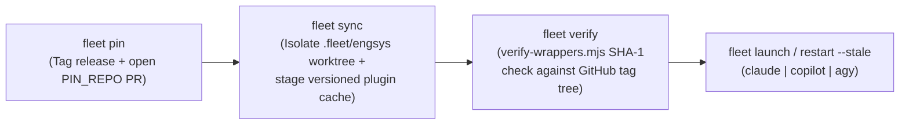

# Spec: Operator-Selectable Multi-Harness Support (`claude` | `copilot` | `antigravity`) for `engsys` (`v1.0.0`)

**Target Repository:** `eric-sabe/engsys` (`/Users/eric/git/engineering/engsys` — generic mechanism, zero org-specific leaks)  
**Spec Path (target):** `docs/specs/multi-harness-support.md`

### Scope & Spec Tier Recommendation (from Phase 1 Exploration)
- **Blast radius**: `~35 files across 6 subsystems (installer, scripts/build-plugins.mjs, core/.claude-plugin hooks, lease/baton, agent-sessions, fleet kit); 4 Epic PR phases (Issues #2, #6, #7, #8)`
- **Triggered Escalation Tripwires (`TW-1..TW-6`)**:
  - `TW-1` (Data Model / Schema Migration): Mutates `engsys.config.yaml` (`harness:`), `engsys.lock`, `fleet.conf` (`HARNESS=`), `pin.json`, and `plugins.json` schemas.
  - `TW-2` (Public API / CLI / Wire Protocol): Normalizes hook JSON envelopes (`harness-io.mjs`) across Claude Code, Copilot CLI, and Antigravity (`agy`), and adds `--harness` flags to `install` and `fleet`.
  - `TW-3` (Auth / Trust Boundary / Security): Touches [`singleton-write-guard.mjs`](file:///Users/eric/git/engineering/engsys/core/.claude-plugin/singleton-write-guard.mjs), [`verify-wrappers.mjs`](file:///Users/eric/git/engineering/engsys/core/fleet/lib/verify-wrappers.mjs), and [`identity/bin/gh`](file:///Users/eric/git/engineering/engsys/core/fleet/identity/bin/gh) security boundaries.
  - `TW-4` (Multi-PR / Cross-Subsystem): Spans 4 phases in the Unified Epic (`Issue #2`, `Issue #6`, `Issue #7`, `Issue #8`).
  - `TW-5` (AI / LLM / Agentic Pipeline): Adds `_copilot-cli.mjs` and `_agy-cli.mjs` worker execution providers and translates persona frontmatter for `.agents/agents/*.md`.
  - `TW-6` (Infra / CI / Deploy Topology): Updates `scripts/build-plugins.mjs`, `fleet sync` per-instance git worktrees, and launchd/systemd supervisor jobs.
- **Recommended Tier**: **Tier L** (All 6 tripwires fire).
- **Harmonized Unified Epic Alignment**:
  - Implemented as **Track C** of [`engsys-unified-epic-spec.md`](file:///Users/eric/git/engineering/engsys-unified-epic-spec.md) across **Epic Phase 2 (`Issue #2`)**, **Epic Phase 6 (`Issue #6`)**, **Epic Phase 7 (`Issue #7`)**, and **Epic Phase 8 (`Issue #8`)**.

---

## Goal

Enable an operator to choose their agent harness (`claude`, `copilot`, `antigravity`, or `all`) when bringing `engsys` into a project (`engsys init` / `engsys install`) or scaffolding a multi-session fleet (`engsys fleet init`), and have every downstream subsystem—hooks, subagent context packs, worktree isolation, distributed batons, cryptographic plugin verification (`fleet verify`), zero-downtime upgrades (`fleet pin` $\rightarrow$ `fleet sync` $\rightarrow$ `fleet restart`), monster watchers, and multi-fleet federation—adapt deterministically to that choice without prose guesswork.

---

## Context

`engsys` v1.13.1 is ~75% harness-agnostic: its distributed state (GitHub ref CAS batons in [`baton.mjs`](file:///Users/eric/git/engineering/engsys/core/lib/lease/baton.mjs), durable leases in [`durable-lease.mjs`](file:///Users/eric/git/engineering/engsys/core/lib/durable-lease.mjs), signed GitHub gates in [`gate-check.mjs`](file:///Users/eric/git/engineering/engsys/core/lib/gate-check.mjs), cross-fleet PR-comment relay in [`relay.mjs`](file:///Users/eric/git/engineering/engsys/core/fleet/relay.mjs), and GitHub App token minting in [`gh-app-token.mjs`](file:///Users/eric/git/engineering/engsys/core/fleet/identity/gh-app-token.mjs)) lives in Node.js and Bash scripts outside the LLM harness.

However, the remaining 25% hardcodes Claude Code (`claude` CLI) assumptions across five boundaries, where **GitHub Copilot CLI (`copilot` v1.0.45)** and **Google Antigravity (`agy` v1.23.2 / 2.0)** differ in specific, testable ways:

1. **Installer & Materializer ([`install`](file:///Users/eric/git/engineering/engsys/install), [`lib/commands.js`](file:///Users/eric/git/engineering/engsys/lib/commands.js), [`lib/render.js`](file:///Users/eric/git/engineering/engsys/lib/render.js))**: Always writes `.claude/`, `CLAUDE.md`, `.mcp.json`, and `.claude/engsys.lock`.
   - **Copilot CLI (`copilot`)** natively reads `CLAUDE.md`, `AGENTS.md`, `.claude/skills/`, `.claude/agents/`, and `.claude/settings.json`, plus `.github/copilot/settings.json` and `.github/skills/` / `.github/agents/`.
   - **Antigravity (`agy`)** reads `.agents/` (`skills/`, `agents/`, `workflows/`, `hooks.json`, `mcp_config.json`, `plugins.json`) and `AGENTS.md`.
2. **Lifecycle Hook Wire Protocol ([`core/.claude-plugin/*.mjs`](file:///Users/eric/git/engineering/engsys/core/.claude-plugin))**:
   - **Copilot CLI (`copilot`)** supports all 6 hook events used by `engsys` (`SessionStart`, `PreToolUse`, `PostToolUse`, `UserPromptSubmit`/`userPromptTransformed`, `SubagentStop`, `Stop`) and automatically maps PascalCase `PreToolUse` tool names (`bash` $\rightarrow$ `Bash`, `edit` $\rightarrow$ `Edit`, `create` $\rightarrow$ `Write`) and `${CLAUDE_PLUGIN_ROOT}`, **but differs in `stdout` JSON parsing**:
     - `SessionStart` requires top-level `{"additionalContext": "..."}` JSON (plain text from [`post-compact-reground.sh.tmpl`](file:///Users/eric/git/engineering/engsys/core/templates/post-compact-reground.sh.tmpl) / [`post-clear-reground.sh.tmpl`](file:///Users/eric/git/engineering/engsys/core/templates/post-clear-reground.sh.tmpl) or nested-only `hookSpecificOutput.additionalContext` from [`engsys-context.mjs`](file:///Users/eric/git/engineering/engsys/core/.claude-plugin/engsys-context.mjs) is dropped).
     - `PreToolUse` reads top-level `permissionDecision` and `permissionDecisionReason`.
     - `Stop` and `SubagentStop` ([`handback-guard.mjs`](file:///Users/eric/git/engineering/engsys/core/.claude-plugin/handback-guard.mjs)) require `stdout` `{"decision": "block", "reason": "..."}` with exit `0` (exit `2` is only a warning in `copilot` for `Stop`/`SubagentStop`).
     - `UserPromptSubmit` ([`fleet-inbox.mjs`](file:///Users/eric/git/engineering/engsys/core/.claude-plugin/fleet-inbox.mjs)) drops command-hook `stdout`; cross-fleet inbox delivery must also hook `PostToolUse` (or `userPromptTransformed`).
   - **Antigravity (`agy`)** sends `camelCase` protojson (`toolCall: {name: "run_command"|"replace_file_content"|"write_to_file"|"invoke_subagent", args: {...}}`, `conversationId`) and expects `stderr` + exit `2` on `PreToolUse` deny or `Stop` block.
3. **Plugin Pinning, Syncing & Cryptographic Verification ([`pin.sh`](file:///Users/eric/git/engineering/engsys/core/fleet/pin.sh), [`sync.sh`](file:///Users/eric/git/engineering/engsys/core/fleet/sync.sh), [`verify.sh`](file:///Users/eric/git/engineering/engsys/core/fleet/verify.sh), [`verify-wrappers.mjs`](file:///Users/eric/git/engineering/engsys/core/fleet/lib/verify-wrappers.mjs))**:
   - **Copilot CLI (`copilot`)** natively reads `.claude-plugin/marketplace.json` and `.claude-plugin/plugin.json` (verified empirically on `copilot` v1.0.45 with `engsys@engsys` and `feedfrwd@feedfrwd`!), supports `extraKnownMarketplaces` and `enabledPlugins`, and provides `COPILOT_HOME` and repeatable `--plugin-dir <dir>`. Its `$COPILOT_HOME/config.json` is JSONC (`//` header comments) with `installedPlugins[].cache_path`.
   - **Antigravity (`agy`)** uses workspace [`.agents/plugins.json`](file:///Users/eric/.gemini/antigravity/builtin/skills/agy-customizations/docs/json_configs.md) pointing to a version-keyed cache (`~/.local/share/engsys-fleet/plugins/<marketplace>/<tag>/`).
4. **Process-Tree, Tmux Supervision & Auth Separation ([`baton.mjs`](file:///Users/eric/git/engineering/engsys/core/lib/lease/baton.mjs#L189-L197), [`launch-agent-sessions.sh`](file:///Users/eric/git/engineering/engsys/core/skills/agent-sessions/scripts/launch-agent-sessions.sh), [`fleet-supervisor.sh`](file:///Users/eric/git/engineering/engsys/core/skills/agent-sessions/scripts/fleet-supervisor.sh), [`identity/bin/gh`](file:///Users/eric/git/engineering/engsys/core/fleet/identity/bin/gh))**:
   - `baton.mjs` checks only for `claude` (`isClaudeCommand`).
   - In `copilot` fleet lanes, [`identity/bin/gh`](file:///Users/eric/git/engineering/engsys/core/fleet/identity/bin/gh) must never hand a GitHub App installation token (`ghs_...`) to the `copilot` parent binary if `copilot` invokes `gh auth token` for Copilot seat authentication, while strictly enforcing that all agent-invoked `gh` and `git` commands authenticate as the Fleet GitHub App bot.

---

## Operator Inputs (Consolidated from Warm-Chat Ideation)

1. **Existing Projects Stay Put**: Existing Claude Code deployments (`FeedFrwd/keystone` via `ff-engsys-fleet`) will **not** switch off Claude Code; `claude` remains the default when `harness` is omitted, with zero breaking changes to existing `engsys.config.yaml` or `fleet/fleet.conf` files.
2. **Project-Level & Fleet-Level Choice (`claude` | `copilot` | `antigravity`)**: Operators can select `claude`, `copilot`, or `antigravity` (or `all` for standalone repos) when onboarding a project or initializing a fleet, and `engsys` adapts across standalone workflows and multi-fleet operations.
3. **Multi-Fleet & Project-Specific Versioning Required**: All three harnesses must support:
   - Project-pinned versions in `PIN_REPO` (`fleet pin` $\rightarrow$ `fleet sync` $\rightarrow$ `fleet verify` $\rightarrow$ `fleet restart`).
   - Running multiple project fleets on the **same physical host** (e.g., Keystone on `claude` at `engsys v1.13.1`, Project B on `copilot` at `engsys v1.14.0`, Project C on `antigravity` at `engsys v1.14.0`) without `ENGSYS_DIR` or plugin cache collisions.
   - Multi-operator federation (`federation.yml`) with home/standby singleton monster routing and GitHub-fenced batons.

---

## Assumptions

- `claude` (Claude Code CLI), `copilot` (GitHub Copilot CLI $\ge$ 1.0.45), or `agy` (Google Antigravity CLI $\ge$ 1.23.2 / 2.0) is pre-installed on hosts configured for that harness.
- All three harnesses natively discover skills at `skills/<name>/SKILL.md` and agents at `agents/<name>.md` within a plugin root.
- Both `claude` and `copilot` natively read `.claude-plugin/marketplace.json`, `.claude-plugin/plugin.json`, `extraKnownMarketplaces`, and `enabledPlugins`.

---

## Non-Goals

- Migrating `FeedFrwd/keystone` (`ff-engsys-fleet`) off Claude Code.
- Building custom forks of `claude`, `copilot`, or `agy` binaries.
- Routing cross-fleet (cross-host) messages through vendor cloud session APIs (cross-fleet messaging remains strictly GitHub-backed via [`relay.mjs`](file:///Users/eric/git/engineering/engsys/core/fleet/relay.mjs)).

---

## Open Questions

- *None blocking implementation*: Default model aliases in `fleet/fleet.conf` (`MM_MODEL`, `MAINTAIN_MODEL`, `BUILD_MODEL`, `SECURITY_MODEL`) map per harness (`opus`/`sonnet`/`haiku` on `claude` pinned to `claude-opus-5-5`/`claude-sonnet-5-5`/`claude-haiku-5-5` with `claude-opus-4-8` for security; `claude-opus-5.5`/`claude-sonnet-5.5`/`claude-haiku-5.5` with `claude-opus-4.8` for security or `gpt-6-astra`/`gpt-6.1-sol`/`gpt-6-luna` on `copilot`; `gemini-4-argon` and `gemini-3.8-flash` on `antigravity`).

---

## Product and UX Specification

### Operator Personas & Onboarding Flows (`Leith`)

#### Flow 1: Standalone Project Onboarding (`engsys init` $\rightarrow$ `engsys install`)
1. Operator runs `engsys init --into /path/to/repo` and sets `harness` in `engsys.config.yaml`:
   ```yaml
   harness: copilot   # claude (default) | copilot | antigravity | all
   ```
2. Operator runs `engsys install --into /path/to/repo`:
   - **`harness: claude` (or omitted)**: Materializes `.claude/`, `CLAUDE.md`, `.mcp.json`, and `.claude/engsys.lock` (identical to v1.13.1).
   - **`harness: copilot`**: Materializes `.claude/` (`agents/`, `skills/`, `commands/`, `workflows/`, `scripts/`, `lib/`, `settings.json`, `engsys.lock` — all natively loaded by Copilot CLI!), `.github/copilot/settings.json` (wiring hooks and permissions), `CLAUDE.md`, and `AGENTS.md`.
   - **`harness: antigravity`**: Materializes `.agents/` (`agents/`, `skills/`, `workflows/`, `scripts/`, `lib/`, `hooks.json`, `mcp_config.json`, `engsys.lock`) and `AGENTS.md`. Slash commands in `core/commands/*.md` are materialized as `.agents/skills/<cmd>/SKILL.md`.
   - **`harness: all`**: Materializes `.claude/` + `.github/copilot/settings.json` + `.agents/` + `CLAUDE.md` + `AGENTS.md`, tracked atomically in `.claude/engsys.lock`.

#### Flow 2: Fleet Instance Onboarding (`engsys fleet init`)
1. Operator runs:
   ```bash
   engsys fleet init --into ~/git/acme-fleet \
     --harness copilot \
     --org acme --namespace acme \
     --pin-repo Acme/webapp --pin-dir ~/git/acme/webapp \
     --instance-marketplace acme --identity github-app --fleet eric
   ```
2. `engsys fleet init`:
   - Writes `HARNESS=copilot` (or `claude` / `antigravity`) into `fleet/fleet.conf`.
   - Scaffolds tri-harness plugin manifests in `plugin/` (`plugin/.claude-plugin/plugin.json` + `plugin/hooks/hooks.json` for `claude` and `copilot`, plus `plugin/plugin.json` + `plugin/hooks.json` for `antigravity`).
   - Prints step-by-step pin instructions for `PIN_REPO` (`.claude/settings.json` for `claude`/`copilot`, or `.agents/plugins.json` for `antigravity`).

#### Flow 3: Day-2 Fleet Lifecycle (`fleet pin` $\rightarrow$ `fleet sync` $\rightarrow$ `fleet verify` $\rightarrow$ `fleet launch` $\rightarrow$ `fleet restart`)



- **`fleet pin --engsys v1.14.0 --release next`**:
  - Stamps `.version` in both `.claude-plugin/plugin.json` and root `plugin.json`, validates the plugin, tags and releases on GitHub, and opens a pin-only PR in `PIN_REPO`.
- **`fleet sync`**:
  - Fast-forwards `PIN_DIR`, checks out `FLEET_REPO` at `INSTANCE_REF`, checks out an instance-isolated `ENGSYS_DIR` worktree (`$FLEET_STATE/engsys`) at `ENGSYS_REF`, and installs into the harness's isolated store:
    - `claude`: `CLAUDE_CONFIG_DIR=$FLEET_STATE/claude-config` (or user scope)
    - `copilot`: `COPILOT_HOME=$FLEET_STATE/copilot-home copilot plugin marketplace add ... && copilot plugin install ...` (plus versioned directory at `~/.local/share/engsys-fleet/plugins/<marketplace>/<tag>/`)
    - `antigravity`: `~/.local/share/engsys-fleet/plugins/<marketplace>/<tag>/<plugin>/`
- **`fleet verify`**:
  - Runs [`verify-wrappers.mjs`](file:///Users/eric/git/engineering/engsys/core/fleet/lib/verify-wrappers.mjs) against the active harness's resolved install roots (`claude plugin list --json` for `claude`, `$COPILOT_HOME/config.json` `installedPlugins[].cache_path` for `copilot`, or `.agents/plugins.json` roots for `antigravity`) to confirm every regular file matches GitHub's `refs/tags/<ENGSYS_REF>` commit tree byte-for-byte (`exit 0`).
- **`fleet launch` & `fleet restart --stale`**:
  - For `HARNESS=copilot`, launches each `tmux` window with:
    `copilot --name "<session>" -i "<prompt>" --mode autopilot --no-ask-user --yolo ${REMOTE:+--remote} --model "<model>" --add-dir ... --plugin-dir ...`
  - For `fleet restart`, resumes via `copilot --resume="<session>"` (or rotates monsters via `tmux send-keys` with `$ROTATE_MSG`).

---

## Architecture Specification

### Config and Lockfile Contract

```typescript
// Schema delta for engsys.config.yaml (parsed by lib/manifest.js & lib/commands.js)
export type HarnessKind = 'claude' | 'copilot' | 'antigravity' | 'all';

export interface EngsysProjectConfig {
  project: { name: string; description: string };
  harness?: HarnessKind; // default: 'claude'
  stack: Record<string, string | string[]>;
  issue_tracker?: 'github' | 'linear' | 'jira';
  providers?: Record<string, unknown>;
  agents?: { core?: 'all' | string[]; extra?: string[] };
  commands?: 'all' | string[];
  lessons?: { seed?: boolean; into?: string };
  naturalize?: Record<string, unknown>;
  engsys?: { version?: string };
}
```

In `fleet/fleet.conf` and `federation.yml`:
```ini
# fleet/fleet.conf
# Agent harness for sessions in this fleet instance: claude (default) | copilot | antigravity
HARNESS=copilot
```
```yaml
# federation.yml (optional per-fleet override — allows mixed-harness federations!)
fleets:
  eric:
    operator: "@eric-sabe"
    harness: claude        # Keystone host or primary operator on Claude Code
  cto:
    operator: "@cto-handle"
    harness: copilot       # Second fleet host running GitHub Copilot CLI
```

### Tri-Harness Hook Protocol Adapter (`core/lib/harness-io.mjs`)

Create `core/lib/harness-io.mjs` with zero external dependencies so all 6 hooks in [`core/.claude-plugin/`](file:///Users/eric/git/engineering/engsys/core/.claude-plugin) (`approve-own-scripts.mjs`, `singleton-write-guard.mjs`, `handback-guard.mjs`, `engsys-context.mjs`, `fleet-gh-path.mjs`, `fleet-inbox.mjs`) and [`fleet-context.sh`](file:///Users/eric/git/engineering/engsys/core/fleet/scaffold/plugin/hooks/fleet-context.sh) work identically across `claude`, `copilot`, and `antigravity`:

```javascript
// core/lib/harness-io.mjs
import path from 'node:path';
import { fileURLToPath } from 'node:url';

export function resolvePluginRoot(importMetaUrl, env = process.env) {
  return (
    env.CLAUDE_PLUGIN_ROOT ||
    env.COPILOT_PLUGIN_ROOT ||
    env.PLUGIN_ROOT ||
    env.ENGSYS_PLUGIN_ROOT ||
    path.resolve(path.dirname(fileURLToPath(importMetaUrl)), '..')
  );
}

export function detectHarness(input, env = process.env) {
  if (env.ENGSYS_HARNESS === 'copilot' || env.ENGSYS_HARNESS === 'antigravity' || env.ENGSYS_HARNESS === 'claude') {
    return env.ENGSYS_HARNESS;
  }
  if (input && (typeof input.toolCall === 'object' || typeof input.conversationId === 'string' || Array.isArray(input.workspacePaths))) {
    return 'antigravity';
  }
  if (input && ('toolName' in input || ' toolArgs' in input || 'sessionId' in input)) {
    return 'copilot';
  }
  return 'claude';
}

export function normalizeHookInput(raw, env = process.env) {
  const harness = detectHarness(raw, env);
  if (harness === 'antigravity') {
    const rawName = raw?.toolCall?.name ?? '';
    const args = raw?.toolCall?.args ?? {};
    const canonicalTool =
      rawName === 'run_command' ? 'Bash' :
      rawName === 'write_to_file' ? 'Write' :
      rawName === 'replace_file_content' || rawName === 'multi_replace_file_content' ? 'Edit' :
      rawName;
    return {
      harness: 'antigravity',
      sessionId: raw?.conversationId ?? '',
      cwd: raw?.workspacePaths?.[0] ?? process.cwd(),
      transcriptPath: raw?.transcriptPath ?? '',
      toolName: canonicalTool,
      rawToolName: rawName,
      toolInput: {
        command: args.CommandLine,
        file_path: args.TargetFile,
        ...args,
      },
      stopHookActive: Boolean(raw?.stop_hook_active),
      lastAssistantMessage: raw?.last_assistant_message ?? '',
      agentId: raw?.agent_id ?? '',
      agentType: raw?.agent_type ?? '',
    };
  }

  // Claude Code & Copilot CLI (both PascalCase snake_case and camelCase)
  const rawTool = raw?.tool_name ?? raw?.toolName ?? '';
  let parsedArgs = raw?.tool_input ?? raw?.toolArgs ?? {};
  if (typeof parsedArgs === 'string') {
    try { parsedArgs = JSON.parse(parsedArgs); } catch { parsedArgs = {}; }
  }
  const canonicalTool =
    rawTool === 'bash' || rawTool === 'powershell' ? 'Bash' :
    rawTool === 'create' ? 'Write' :
    rawTool === 'edit' || rawTool === 'str_replace_editor' || rawTool === 'apply_patch' ? 'Edit' :
    rawTool === 'view' ? 'Read' :
    rawTool;

  return {
    harness,
    sessionId: raw?.session_id ?? raw?.sessionId ?? '',
    cwd: raw?.cwd ?? process.cwd(),
    transcriptPath: raw?.transcript_path ?? raw?.transcriptPath ?? '',
    toolName: canonicalTool,
    rawToolName: rawTool,
    toolInput: parsedArgs,
    stopHookActive: Boolean(raw?.stop_hook_active),
    lastAssistantMessage: raw?.last_assistant_message ?? raw?.response ?? '',
    agentId: raw?.agent_id ?? raw?.agentId ?? '',
    agentType: raw?.agent_type ?? raw?.agentType ?? raw?.agentName ?? '',
  };
}

/**
 * Emits PreToolUse allow/deny in a single JSON envelope consumed by both Claude Code
 * (hookSpecificOutput) and Copilot CLI (top-level permissionDecision), or stderr+exit 2 for Antigravity.
 */
export function emitPreToolDecision(harness, { decision, reason }) {
  if (harness === 'antigravity') {
    if (decision === 'deny') {
      process.stderr.write(`${reason || 'Denied by engsys PreToolUse hook'}\n`);
      return 2;
    }
    return 0;
  }
  const out = {
    permissionDecision: decision,
    ...(reason ? { permissionDecisionReason: reason } : {}),
    hookSpecificOutput: {
      hookEventName: 'PreToolUse',
      permissionDecision: decision,
      ...(reason ? { permissionDecisionReason: reason } : {}),
    },
  };
  process.stdout.write(`${JSON.stringify(out)}\n`);
  return 0;
}

/**
 * Emits SessionStart / PostToolUse context injection with both top-level additionalContext
 * (required by Copilot CLI) and hookSpecificOutput.additionalContext (used by Claude Code).
 */
export function emitAdditionalContext(eventName, text) {
  if (!text) return 0;
  const out = {
    additionalContext: text,
    hookSpecificOutput: {
      hookEventName: eventName,
      additionalContext: text,
    },
  };
  process.stdout.write(`${JSON.stringify(out)}\n`);
  return 0;
}

/**
 * Emits Stop / SubagentStop block decision. Both Claude Code and Copilot CLI consume
 * stdout {"decision": "block", "reason": "..."} on exit 0; Antigravity uses stderr + exit 2.
 */
export function emitStopBlock(harness, reason) {
  if (harness === 'antigravity') {
    process.stderr.write(`${reason}\n`);
    return 2;
  }
  process.stdout.write(`${JSON.stringify({ decision: 'block', reason })}\n`);
  return 0;
}
```

### Required Updates to [`core/.claude-plugin/`](file:///Users/eric/git/engineering/engsys/core/.claude-plugin) Hooks

1. **[`singleton-write-guard.mjs`](file:///Users/eric/git/engineering/engsys/core/.claude-plugin/singleton-write-guard.mjs)**:
   - Use `normalizeHookInput()` and `emitPreToolDecision()` from `../lib/harness-io.mjs`, and resolve `pluginRoot` via `resolvePluginRoot(import.meta.url, env)`.
   - Extend `protectedPath(p, ctx)` and `SETTINGS_RE` so a `merge` or `maintain` monster session cannot modify or disable hooks in **any** harness:
     - Existing protected paths: `.claude/**`, `managed-settings.json`, `.git/config`, `~/.gitconfig`, plugin cache.
     - New protected paths: `.github/hooks/**`, `.github/copilot/**`, `$COPILOT_HOME/**` (`~/.copilot/**`), `.gemini/**`, `.agents/**`.
2. **[`approve-own-scripts.mjs`](file:///Users/eric/git/engineering/engsys/core/.claude-plugin/approve-own-scripts.mjs)**:
   - Use `normalizeHookInput()`, `resolvePluginRoot()`, and `emitPreToolDecision()` so both `claude` and `copilot` receive top-level `permissionDecision: "allow"` + `hookSpecificOutput`.
3. **[`handback-guard.mjs`](file:///Users/eric/git/engineering/engsys/core/.claude-plugin/handback-guard.mjs)**:
   - Use `normalizeHookInput()` (mapping `response` / `last_assistant_message` and `agentType` / `agent_type`) and `emitStopBlock(harness, reason)` (`{"decision": "block", "reason": "..."}` on `stdout` with exit `0` for `claude` and `copilot`; `stderr` + exit `2` for `antigravity`).
4. **[`engsys-context.mjs`](file:///Users/eric/git/engineering/engsys/core/.claude-plugin/engsys-context.mjs), [`fleet-context.sh`](file:///Users/eric/git/engineering/engsys/core/fleet/scaffold/plugin/hooks/fleet-context.sh), [`post-compact-reground.sh.tmpl`](file:///Users/eric/git/engineering/engsys/core/templates/post-compact-reground.sh.tmpl), and [`post-clear-reground.sh.tmpl`](file:///Users/eric/git/engineering/engsys/core/templates/post-clear-reground.sh.tmpl)**:
   - Emit both top-level `additionalContext` and nested `hookSpecificOutput.additionalContext` JSON on `stdout` so Copilot CLI's `JSON.parse()` on `sessionStart` never drops context.
5. **[`fleet-inbox.mjs`](file:///Users/eric/git/engineering/engsys/core/.claude-plugin/fleet-inbox.mjs) & [`core/.claude-plugin/hooks.json`](file:///Users/eric/git/engineering/engsys/core/.claude-plugin/hooks.json)**:
   - Emit top-level `additionalContext` alongside `hookSpecificOutput.additionalContext`.
   - Also wire `fleet-inbox.mjs` under `PostToolUse` in `core/.claude-plugin/hooks.json` (guarded by the same fast `grep -qs '"delivered_at":null'` check) so harnesses that ignore `UserPromptSubmit` command stdout (`copilot` and `antigravity`) still deliver cross-fleet relay pointers automatically on the next tool call.

### Fleet GitHub App Identity vs. Copilot Seat Auth Contract ([`core/fleet/identity/bin/gh`](file:///Users/eric/git/engineering/engsys/core/fleet/identity/bin/gh))

In [`core/fleet/identity/bin/gh`](file:///Users/eric/git/engineering/engsys/core/fleet/identity/bin/gh), add a parent-process check at the top of the shim:
```bash
# If the GitHub Copilot CLI binary itself calls `gh auth token` or `gh auth status` to authenticate
# the operator's Copilot seat, do NOT hand it a GitHub App installation token (ghs_...), which has
# no Copilot subscription. Agent Bash tool calls run under a shell/node/git child process, never
# with `copilot` as their direct PPID calling `gh auth token`.
if [ "${1:-}" = "auth" ] && { [ "${2:-}" = "token" ] || [ "${2:-}" = "status" ]; }; then
  parent_comm="$(ps -o comm= -p "$PPID" 2>/dev/null | awk -F/ '{print $NF}' | sed 's/^-//')"
  if [ "$parent_comm" = "copilot" ]; then
    exec "$REAL_GH" "$@"
  fi
fi
```
This guarantees:
1. `copilot` authenticates to `api.githubcopilot.com` with the operator's personal Copilot seat.
2. Every `gh` and `git` command executed by the agent (or by `mm-act.sh`, `mnt-act.sh`, `baton.mjs`, `relay.mjs`) runs under a child shell/node process and authenticates strictly as the **Fleet GitHub App (`<org>-fleet[bot]`)**.

### Fleet Pin, Sync, and Verify Contract (`claude` | `copilot` | `antigravity`)

1. **`verify-wrappers.mjs` Multi-Harness Install Discovery**:
   Extend `selectInstalls(list, { pluginId, projectDir, version })` in [`verify-wrappers.mjs`](file:///Users/eric/git/engineering/engsys/core/fleet/lib/verify-wrappers.mjs#L142-L159) and [`verify.sh`](file:///Users/eric/git/engineering/engsys/core/fleet/verify.sh#L76-L95):
   - **`HARNESS=claude`**: Runs `(cd "$PIN_DIR" && claude plugin list --json)` (existing behavior).
   - **`HARNESS=copilot`**: Reads `$COPILOT_HOME/config.json` (stripping leading `//` JSONC comment lines), normalizes `installedPlugins[]` (`{ id: "${e.name}@${e.marketplace}", version: e.version, installPath: e.cache_path, enabled: e.enabled }`), strips `.DS_Store` if absent in git, and verifies every file in `cache_path` against GitHub's `refs/tags/<ENGSYS_REF>` commit tree via `compare(rel.tree, local)`.
   - **`HARNESS=antigravity`**: Reads `$PIN_DIR/.agents/plugins.json`, checks that no global `~/.gemini/config/plugins/` entry shadows `engsys`, and verifies the resolved version-keyed cache directory against GitHub's `refs/tags/<ENGSYS_REF>` commit tree.
2. **Per-Instance `ENGSYS_DIR` Worktree Isolation in [`sync.sh`](file:///Users/eric/git/engineering/engsys/core/fleet/sync.sh)**:
   - `sync.sh` fetches tags into `$ENGSYS_DIR` (`~/git/engsys`) and materializes a per-instance detached worktree at `$FLEET_STATE/engsys` at `$want_engsys` whenever multiple fleet instances share a host, preventing Project B's `fleet sync` from moving Project A's `ENGSYS_DIR` checkout.

### Session Launcher, Supervisor, and Baton Contract

1. **[`baton.mjs`](file:///Users/eric/git/engineering/engsys/core/lib/lease/baton.mjs#L189-L197) (`isClaudeCommand`)**:
   ```javascript
   export function isClaudeCommand(comm) {
     const name = path.basename(String(comm || '').trim());
     if (!name) return false;
     if (name === 'claude' || name === 'claude-code' || name === 'copilot' || name === 'agy' || name === 'language_server') return true;
     if (/^\d+\.\d+\.\d+(-[\w.]+)?$/.test(name)) return true;
     return false;
   }
   ```
2. **[`launch-agent-sessions.sh`](file:///Users/eric/git/engineering/engsys/core/skills/agent-sessions/scripts/launch-agent-sessions.sh)**:
   - **`HARNESS=claude` (default)**: `claude --name "$NAME" ... "$PROMPT"`
   - **`HARNESS=copilot`**:
     - Maps `--dangerously-skip-permissions` to `--yolo --mode autopilot --no-ask-user` (so monsters run autonomously and cannot stall on `ask_user`).
     - Maps `--remote-control` (`--remote`) to `--remote`.
     - Maps model aliases (`opus` $\rightarrow$ `claude-opus-5.5`, `sonnet` $\rightarrow$ `claude-sonnet-5.5`, `haiku` $\rightarrow$ `claude-haiku-5.5`, `claude-opus-4-8` $\rightarrow$ `claude-opus-4.8`, passing explicit model IDs like `gpt-6-astra` or `gpt-6.1-sol` through unchanged).
     - Launches `copilot --name "$NAME" -i "$PROMPT" ...`.
     - Resumes on `fleet restart` via `copilot --resume="$NAME"`.
   - **`HARNESS=antigravity`**: Launches `agy` with workspace and prompt arguments.
3. **[`fleet-supervisor.sh`](file:///Users/eric/git/engineering/engsys/core/skills/agent-sessions/scripts/fleet-supervisor.sh#L372-L391) (`auth_probe`)**:
   - When `HARNESS=copilot`, `auth_probe()` runs:
     `copilot -p 'Reply with the single word OK' -s --no-custom-instructions --disable-builtin-mcps --model claude-haiku-5.5`
     and `auth_scan()` checks for both Claude and Copilot auth error lines.

---

## Security and Privacy Specification

### Threat Model & Negative Assertions (`Nyx`)

- **`NA-1` (Singleton Write Guard — Unfenced Bash/Command Execution Across All Harnesses)**: Given `ENGSYS_SINGLETON_ROLE=merge` or `maintain` and a `PreToolUse` payload from `claude`, `copilot` (`toolName: "bash"` or `"Bash"`), or `antigravity` (`toolCall.name: "run_command"`) invoking raw `gh pr merge`, `git push`, or a wrapper outside the verified plugin root, [`singleton-write-guard.mjs`](file:///Users/eric/git/engineering/engsys/core/.claude-plugin/singleton-write-guard.mjs) MUST deny the call (emitting top-level `permissionDecision: "deny"` + `hookSpecificOutput.permissionDecision: "deny"` for `claude`/`copilot`, and `stderr` + exit `2` for `antigravity`).
- **`NA-2` (Singleton Write Guard — Cross-Harness Hook/Settings Tampering)**: Given `ENGSYS_SINGLETON_ROLE=merge` or `maintain`, `singleton-write-guard.mjs` MUST deny any `Write`/`Edit`/`create`/`edit`/`write_to_file`/`replace_file_content` or `Bash` command that writes to `.claude/**`, `.github/hooks/**`, `.github/copilot/**`, `$COPILOT_HOME/**` (`~/.copilot/**`), `.gemini/**`, `.agents/**`, `.git/config`, `~/.gitconfig`, or the plugin cache, preventing a session from setting `"disableAllHooks": true` in any harness.
- **`NA-3` (Plugin Integrity Gate — Modified or Unexpected Files in Any Harness)**: Given `HARNESS=claude`, `copilot`, or `antigravity` and a single modified byte, extra file, or symlink inside the active plugin root, [`verify.sh`](file:///Users/eric/git/engineering/engsys/core/fleet/verify.sh) MUST exit `1` (`verify: MISMATCH`), [`launch.sh`](file:///Users/eric/git/engineering/engsys/core/fleet/launch.sh) MUST refuse to start `merge` or `maintain` sessions, and `notify.mjs` MUST fire the `wrapper-integrity` alert.
- **`NA-4` (Plugin Integrity Gate — Global Shadowing Attack in Antigravity)**: Given `HARNESS=antigravity` and a directory in `~/.gemini/config/plugins/` or `$PIN_DIR/.agents/plugins/` that declares `"name": "engsys"`, `verify-wrappers.mjs` MUST report a `shadowed` mismatch (`exit 1`) and hold singleton monster launch.
- **`NA-5` (Baton Keepalive — Orphan Lease Prevention)**: Given a monster running under `claude`, `copilot`, or `agy` that acquires a lease via [`baton.mjs`](file:///Users/eric/git/engineering/engsys/core/lib/lease/baton.mjs), if the parent harness process terminates (`SIGKILL`), the detached keepalive daemon MUST detect that `ownerPid` is dead on its next check and exit without renewing the lease.
- **`NA-6` (Fleet Identity Shim — Copilot Seat vs. Bot Token Separation)**: Given `HARNESS=copilot` with `GH_APP_ENV` configured, an agent-invoked `gh pr merge` or `git push` under a child shell (`PPID != copilot` or subcommand `!= auth token|status`) MUST never receive the personal operator token; it MUST strictly receive the Fleet GitHub App installation token (`ghs_...`). Conversely, when the `copilot` binary itself (`comm == "copilot"`) calls `gh auth token`, [`identity/bin/gh`](file:///Users/eric/git/engineering/engsys/core/fleet/identity/bin/gh) MUST pass through to `$REAL_GH` so `copilot` never receives a `ghs_...` token without a Copilot seat.

---

## Testing Strategy

### Executable Contract Test Table (`Marcelo`)

| Case ID | Input / Caller State | Expected Outcome / Invariant | Test File |
| :--- | :--- | :--- | :--- |
| **`CT-01`** | `normalizeHookInput()` given Claude, Copilot (`camelCase` and `PascalCase`), and Antigravity `PreToolUse` payloads | Normalizes all three to canonical `toolName` (`Bash`, `Write`, `Edit`), `toolInput.command`, `toolInput.file_path`, and `sessionId` | `core/lib/harness-io.test.mjs` *(new)* |
| **`CT-02`** | `singleton-write-guard.mjs` given Copilot (`toolName: "bash"`, `toolArgs: "{\"command\":\"gh pr merge 42\"}"`) and `ENGSYS_SINGLETON_ROLE=merge` | Exits `0` with stdout containing both top-level `permissionDecision: "deny"` and `hookSpecificOutput.permissionDecision: "deny"` (`NA-1`) | `core/.claude-plugin/singleton-write-guard.test.mjs` |
| **`CT-03`** | `singleton-write-guard.mjs` given Copilot `edit` or Bash targeting `.github/copilot/settings.json`, `.github/hooks/x.json`, or `~/.copilot/settings.json` under `ENGSYS_SINGLETON_ROLE=merge` | Denies write as protected settings path (`NA-2`) | `core/.claude-plugin/singleton-write-guard.test.mjs` |
| **`CT-04`** | `singleton-write-guard.mjs` given Antigravity `replace_file_content` targeting `.gemini/settings.json` under `ENGSYS_SINGLETON_ROLE=maintain` | Exits `2` with denial reason on `stderr` (`NA-1`, `NA-2`) | `core/.claude-plugin/singleton-write-guard.test.mjs` |
| **`CT-05`** | `approve-own-scripts.mjs` given Copilot `PreToolUse` invoking `${COPILOT_PLUGIN_ROOT}/skills/merge-monster/scripts/mm-watch.sh` | Exits `0` with top-level `permissionDecision: "allow"` + `hookSpecificOutput.permissionDecision: "allow"` | `core/.claude-plugin/approve-own-scripts.test.mjs` |
| **`CT-06`** | `handback-guard.mjs` (`subagent` and `stop` modes) given Copilot payload with pending promise (`"will continue once CI finishes"`) | Exits `0` with stdout `{"decision":"block","reason":"engsys hand-back guard:..."}` | `core/.claude-plugin/handback-guard.test.mjs` |
| **`CT-07`** | `engsys-context.mjs`, `fleet-context.sh`, `post-compact-reground.sh.tmpl`, and `post-clear-reground.sh.tmpl` | Emit valid single-object JSON containing both top-level `additionalContext` and `hookSpecificOutput.additionalContext` | `core/.claude-plugin/engsys-context.test.mjs` |
| **`CT-08`** | `isClaudeCommand()` in `baton.mjs` given `"claude"`, `"copilot"`, `"agy"`, `"language_server"` | Returns `true` for all four; `resolveSessionOwnerPid()` binds keepalive to the harness PID (`NA-5`) | `core/lib/lease/baton.test.mjs` |
| **`CT-09`** | `core/fleet/identity/bin/gh` called as `gh auth token` by a child `bash` vs. direct parent `copilot` | Child `bash` receives Fleet GitHub App token (`ghs_...`); direct parent `copilot` delegates to `$REAL_GH auth token` (`NA-6`) | `core/fleet/test/identity.test.sh` |
| **`CT-10`** | `runInstall()` with `harness: copilot`, `harness: antigravity`, and `harness: all` | Materializes expected harness directories and passes `runVerify()` + `runUninstall()` cleanly | `lib/selftest.js` |
| **`CT-11`** | `verify-wrappers.mjs` given JSONC `$COPILOT_HOME/config.json` (`//` header comments + `installedPlugins[].cache_path`) | Parses JSONC cleanly and verifies every file in `cache_path` against GitHub tag tree (`exit 0` on match, `exit 1` on mismatch) (`NA-3`) | `core/fleet/lib/verify-wrappers.test.mjs` |
| **`CT-12`** | `verify-wrappers.mjs` with `HARNESS=antigravity` when `~/.gemini/config/plugins/engsys/plugin.json` exists | Exits `1` (`verify: MISMATCH` with `shadowed`) (`NA-4`) | `core/fleet/lib/verify-wrappers.test.mjs` |
| **`CT-13`** | `fleet sync` on host where two fleet instances pin different `engsys` tags (`v1.13.1` vs `v1.14.0`) | Isolates per-instance worktree at `$FLEET_STATE/engsys` and per-instance plugin roots without clobbering sibling fleet | `core/fleet/test/fleet.test.sh` |
| **`CT-14`** | `launch-agent-sessions.sh` and `fleet-supervisor.sh` with `HARNESS=copilot` | Spawns `copilot --name <n> -i "<prompt>" --mode autopilot --no-ask-user --yolo ...` and runs `copilot -p` in `auth_probe()` | `core/skills/agent-sessions/scripts/fleet-supervisor.test.sh` |
| **`CT-15`** | `worker-run.mjs --check --provider copilot` and `--provider agy` | Invokes `_copilot-cli.mjs` and `_agy-cli.mjs` readiness probes and reports `READY` | `core/scripts/worker-run.test.sh` |

---

## Phased Project Plan (`Jody`)

> [!IMPORTANT]
> In the Unified Epic ([`engsys-unified-epic-spec.md`](file:///Users/eric/git/engineering/engsys-unified-epic-spec.md)), Track C is executed across **Epic Phase 2 (`Issue #2`)**, **Epic Phase 6 (`Issue #6`)**, **Epic Phase 7 (`Issue #7`)**, and **Epic Phase 8 (`Issue #8`)** so that shared files (`scripts/build-plugins.mjs`, `handback-guard.mjs`, `core/templates/settings.json.tmpl`, `lib/manifest.js`, `core/templates/CLAUDE.md.tmpl`, `core/scripts/worker-run.mjs`) are modified exactly once without cross-track merge conflicts.

### Epic Phase 2 (`Issue #2`): Tri-Harness Hook Adapter (`harness-io.mjs`), Guard Hardening, Plugin Generator (`build-plugins.mjs`), Baton PID & Worker Providers
Establishes `core/lib/harness-io.mjs`, updates all hooks in [`core/.claude-plugin/`](file:///Users/eric/git/engineering/engsys/core/.claude-plugin), [`scripts/build-plugins.mjs`](file:///Users/eric/git/engineering/engsys/scripts/build-plugins.mjs) (`packContextSh`, `packPostEditSh`, root `core/plugin.json` + `core/hooks.json`), and [`core/templates/`](file:///Users/eric/git/engineering/engsys/core/templates) (`settings.json.tmpl` copy-mode `handback-guard.mjs` wiring + `post-compact-reground.sh.tmpl` / `post-clear-reground.sh.tmpl`) to emit tri-compatible JSON across `claude`, `copilot`, and `antigravity`. Hardens `singleton-write-guard.mjs` to protect `.github/copilot/**`, `.github/hooks/**`, `$COPILOT_HOME/**`, and `.gemini/**`, and updates `baton.mjs` (`isClaudeCommand`) + `worker-run.mjs` (`_copilot-cli.mjs`, `_agy-cli.mjs`, `contract-check.mjs` gate).

```markdown
<!-- engsys:issue-meta
schema: 1
track: feature
Recommended agent: isabelle
depends_on: [1]
touches:
  - core/lib/harness-io.mjs
  - core/lib/harness-io.test.mjs
  - scripts/build-plugins.mjs
  - core/plugin.json
  - core/hooks.json
  - core/.claude-plugin/hooks.json
  - core/.claude-plugin/approve-own-scripts.mjs
  - core/.claude-plugin/approve-own-scripts.test.mjs
  - core/.claude-plugin/singleton-write-guard.mjs
  - core/.claude-plugin/singleton-write-guard.test.mjs
  - core/.claude-plugin/handback-guard.mjs
  - core/.claude-plugin/handback-guard.test.mjs
  - core/.claude-plugin/engsys-context.mjs
  - core/.claude-plugin/engsys-context.test.mjs
  - core/.claude-plugin/fleet-inbox.mjs
  - core/templates/settings.json.tmpl
  - core/templates/post-compact-reground.sh.tmpl
  - core/templates/post-clear-reground.sh.tmpl
  - core/lib/lease/baton.mjs
  - core/lib/lease/baton.test.mjs
  - core/scripts/providers/_copilot-cli.mjs
  - core/scripts/providers/_agy-cli.mjs
  - core/scripts/worker-run.mjs
  - core/scripts/worker-run.test.sh
risk: high
needs_judgment: true
spec_refs:
  - docs/specs/multi-harness-support.md#Tri-Harness Hook Protocol Adapter (core/lib/harness-io.mjs)
  - docs/specs/multi-harness-support.md#Required Updates to core/.claude-plugin/ Hooks
  - docs/specs/multi-harness-support.md#Threat Model & Negative Assertions (Nyx)
verify:
  - node --test core/lib/harness-io.test.mjs core/.claude-plugin/*.test.mjs core/lib/lease/baton.test.mjs
  - bash core/scripts/worker-run.test.sh
no_external: false
-->
Part of [engsys-2026-unified-epic] · spec: `docs/specs/multi-harness-support.md`
```

### Epic Phase 6 (`Issue #6`): Standalone Installer & Materializer Multi-Harness Support (`harness: claude | copilot | antigravity | all`) & Conditional Skill Manifest
Updates `engsys.config.example.yaml`, `lib/manifest.js` (including Track B retired-skill pruning and conditional `gh-cli` omission on `issue_tracker: linear`), `lib/render.js` (including Antigravity `.agents/agents/*.md` frontmatter translation with `enable_write_tools: false` for read-only critics), `lib/commands.js`, `core/templates/CLAUDE.md.tmpl` (including Track A `/design-change` SDD table), and `lib/selftest.js`.

```markdown
<!-- engsys:issue-meta
schema: 1
track: feature
Recommended agent: isabelle
depends_on: [1, 3, 4, 5]
touches:
  - install
  - engsys.config.example.yaml
  - core/templates/CLAUDE.md.tmpl
  - lib/commands.js
  - lib/manifest.js
  - lib/render.js
  - lib/selftest.js
risk: med
needs_judgment: false
spec_refs:
  - docs/specs/multi-harness-support.md#Config and Lockfile Contract
  - docs/specs/multi-harness-support.md#Operator Personas & Onboarding Flows (Leith)
  - docs/specs/engsys-personas-skills-upgrade.md#Architecture Specification (Melvin)
verify:
  - node install --selftest
no_external: false
-->
Part of [engsys-2026-unified-epic] · spec: `docs/specs/multi-harness-support.md`
```

### Epic Phase 7 (`Issue #7`): Fleet Kit Pin, Sync, Verify & Worktree Isolation (`HARNESS=claude | copilot | antigravity`)
Updates `core/fleet/lib/fleet-env.sh`, `core/fleet/pin.sh`, `core/fleet/sync.sh`, `core/fleet/verify.sh`, `core/fleet/lib/verify-wrappers.mjs`, `core/fleet/identity/bin/gh`, `core/fleet/install-jobs.sh`, and `core/fleet/scaffold/**` to support `--harness claude|copilot|antigravity`, JSONC `$COPILOT_HOME/config.json` and `.agents/plugins.json` verification in `verify-wrappers.mjs`, per-instance `$FLEET_STATE/engsys` git worktree isolation, and the `copilot` parent-process check in `identity/bin/gh`.

```markdown
<!-- engsys:issue-meta
schema: 1
track: feature
Recommended agent: isabelle
depends_on: [2, 6]
touches:
  - core/fleet/lib/fleet-env.sh
  - core/fleet/pin.sh
  - core/fleet/sync.sh
  - core/fleet/verify.sh
  - core/fleet/identity/bin/gh
  - core/fleet/install-jobs.sh
  - core/fleet/lib/verify-wrappers.mjs
  - core/fleet/lib/verify-wrappers.test.mjs
  - core/fleet/scaffold/fleet.conf.example
  - core/fleet/scaffold/project.overlay.yaml.example
  - core/fleet/test/init.test.sh
  - core/fleet/test/pin.test.sh
  - core/fleet/test/fleet.test.sh
  - core/fleet/test/verify.test.sh
risk: high
needs_judgment: true
spec_refs:
  - docs/specs/multi-harness-support.md#Fleet GitHub App Identity vs. Copilot Seat Auth Contract (core/fleet/identity/bin/gh)
  - docs/specs/multi-harness-support.md#Fleet Pin, Sync, and Verify Contract (claude | copilot | antigravity)
  - docs/specs/multi-harness-support.md#Threat Model & Negative Assertions (Nyx)
verify:
  - node --test core/fleet/lib/verify-wrappers.test.mjs
  - bash core/fleet/test/verify.test.sh
no_external: false
-->
Part of [engsys-2026-unified-epic] · spec: `docs/specs/multi-harness-support.md`
```

### Epic Phase 8 (`Issue #8`): Agent Sessions Launcher, Fleet Supervisor, Graceful Restart, Docs & Hermetic E2E Suite
Updates `launch-agent-sessions.sh`, `fleet-supervisor.sh`, `core/fleet/launch.sh`, `core/fleet/restart.sh`, `core/fleet/msg.sh`, monster watcher scripts, and documentation (`README.md`, `docs/fleet-guide.md`, `docs/multi-fleet.md`, `docs/install-scenarios.md`, `docs/architecture.md`) to launch, supervise, auth-probe, and rotate `copilot` and `agy` sessions, and runs the full multi-track end-to-end verification suite.

```markdown
<!-- engsys:issue-meta
schema: 1
track: feature
Recommended agent: isabelle
depends_on: [3, 6, 7]
touches:
  - core/skills/agent-sessions/scripts/launch-agent-sessions.sh
  - core/skills/agent-sessions/scripts/fleet-supervisor.sh
  - core/skills/agent-sessions/scripts/fleet-supervisor.test.sh
  - core/fleet/launch.sh
  - core/fleet/restart.sh
  - core/fleet/msg.sh
  - core/skills/merge-monster/scripts/mm-watch.sh
  - core/skills/merge-monster/scripts/mm-agent-watch.sh
  - core/skills/maintenance-monster/scripts/mnt-watch.sh
  - core/skills/resource-broker/scripts/rb-watch.sh
  - README.md
  - docs/architecture.md
  - docs/fleet-guide.md
  - docs/multi-fleet.md
  - docs/install-scenarios.md
risk: med
needs_judgment: true
spec_refs:
  - docs/specs/multi-harness-support.md#Session Launcher, Supervisor, and Baton Contract
  - docs/specs/multi-harness-support.md#Executable Contract Test Table (Marcelo)
verify:
  - node scripts/run-tests.mjs
  - node scripts/build-plugins.mjs --check
no_external: false
-->
Part of [engsys-2026-unified-epic] · spec: `docs/specs/multi-harness-support.md`
```

---

## Review Checklist

- [ ] Zero org-specific strings (`FeedFrwd`, `keystone`, `macmini-*`) appear anywhere in `eric-sabe/engsys`.
- [ ] Existing projects without `harness:` in `engsys.config.yaml` or `HARNESS=` in `fleet/fleet.conf` default to `claude` and produce byte-identical outputs to v1.13.1.
- [ ] All 6 negative assertions (`NA-1`..`NA-6`) and 15 contract tests (`CT-01`..`CT-15`) pass via `node scripts/run-tests.mjs`.
- [ ] Every issue body created from this spec ends with a parseable `<!-- engsys:issue-meta -->` block with valid `depends_on`, `touches`, `risk`, and `spec_refs` anchors.

